# Project Blindsight ausführlich erklärt

Diese Datei erklärt in Ruhe, was Project Blindsight ist, welche mechanische Idee dahintersteht, wie das Programm rechnet und
was jede Beschriftung in der Oberfläche bedeutet. Sie richtet sich an alle, die das Projekt verstehen oder benutzen wollen,
auch ohne in den Code zu schauen. Befehle für Installation, Tests und Erweiterungen stehen im [README](../README.md).

Alle Zahlen in den Beispielen sind die Standardwerte des Programms. Alle Längen sind in Millimetern, Winkel in Grad, Zeiten
in Sekunden. Die Bilder liegen in `docs/images/` und lassen sich mit `docs/make_images.py` neu zeichnen (siehe Abschnitt 13).

## Inhalt

1. [Die Idee in Kürze](#1-die-idee-in-kürze)
2. [Begriffe](#2-begriffe)
3. [Der mechanische Aufbau](#3-der-mechanische-aufbau)
4. [Warum mehrere Ebenen](#4-warum-mehrere-ebenen)
5. [Platte, Sperrrand, Randbereich und Lochbereich](#5-platte-sperrrand-randbereich-und-lochbereich)
6. [Die drei Modi](#6-die-drei-modi)
7. [Ziele und Prozente](#7-ziele-und-prozente)
8. [Ebenen fest oder nicht fest](#8-ebenen-fest-oder-nicht-fest)
9. [Die Oberfläche Schritt für Schritt](#9-die-oberfläche-schritt-für-schritt)
10. [Ein Durchlauf mit den Standardwerten](#10-ein-durchlauf-mit-den-standardwerten)
11. [Was das Programm verspricht und was nicht](#11-was-das-programm-verspricht-und-was-nicht)
12. [Dateien und Formate](#12-dateien-und-formate)
13. [Die Bilder dieser Datei neu erzeugen](#13-die-bilder-dieser-datei-neu-erzeugen)

## 1. Die Idee in Kürze

- Viele senkrechte Gewindestangen sollen einzeln nach oben und unten fahren. Jede Stange hat ihren eigenen kleinen Motor
- Die Stangen sollen möglichst dicht stehen, also mit kleinem Abstand von Loch zu Loch. Die Motoren sind aber viel breiter
  als die Stangen (Stange 4 mm, Motor N20 mit Encoder 12 x 32 mm). Lägen alle Motoren in einer Ebene, bestimmte der Motor
  den Abstand
- Die Lösung ist ein Stapel aus Platten. Oben liegt die Lochplatte G0, darunter die Motorebenen G1, G2, G3 und so weiter. Jeder
  Motor sitzt seitlich an seiner Stange auf einer dieser Ebenen und treibt sie über ein Zahnrad an, das ins Gewinde greift
- Weil die Motoren benachbarter Stangen auf verschiedenen Ebenen liegen und sich um ihre Stange drehen lassen, dürfen sich ihre
  Gehäuse in der Draufsicht überlappen. Im Raum stoßen sie nicht zusammen
- Project Blindsight rechnet genau diese Geometrie. Es sucht für jede Stange die Ebene, den Drehwinkel und den Achsabstand des
  Motors, prüft jedes Bauteil gegen jedes andere auf Kollision und liefert Bohrbilder und Zeichnungen für die Fertigung

Das Programm weiß nichts über Elektronik, Steuerung oder Festigkeit. Es ist ein geometrischer Rechner. Ob Zahnrad und Gewinde
wirklich gut zusammenarbeiten, muss mit echten Teilen geprüft werden (Abschnitt 3.6 und 11).

## 2. Begriffe

| Begriff | Bedeutung |
|---|---|
| Stange, Gewindestange | Senkrechte Stange mit Gewinde. Sie fährt durch Löcher in den Platten auf und ab |
| G0, Lochplatte | Oberste Platte. Ihre Oberseite ist die Höhe z = 0. Aus ihr fahren die Stangen nach oben heraus |
| Motorebene G1 bis Gn | Platten unter G0, auf denen die Motoren sitzen (oder unter denen sie hängen) |
| Ebene | Oberbegriff für G0 und die Motorebenen |
| Einheit | Eine Stange mit ihrem Motor und ihrem Zahnrad |
| Loch | Durchgangsloch für eine Stange in einer Platte. Jede Stange braucht in jeder Platte ein Loch, durch die sie läuft |
| Lochbild | Die Lage aller Löcher, meist auf G0 betrachtet |
| Hub | Wie weit jede Stange über G0 hinausfahren kann (Standard 50 mm) |
| Achsabstand | Abstand von der Zahnradachse zur Stangenachse |
| Motorwinkel | Drehung des ganzen Motors um seine eigene Stange (0 bis 360 Grad) |
| Sicherheitsabstand und Toleranz | Mindestabstand zwischen fremden Bauteilen. Wirksam ist die Summe, Standard 1 + 0,05 = 1,05 mm |
| Platte, Bauraum | Rechteck, auf dem alles liegen muss. Ursprung (0, 0) unten links |
| Sperrrand | Streifen am Plattenrand, in den kein Bauteil darf |
| Randbereich | Streifen am Plattenrand, in den nur Motoren und Zahnräder dürfen, keine Löcher |
| Lochbereich | Der innere Teil der Platte, in dem alle Stangen liegen müssen |
| Muster | Regelmäßiges Lochbild wie Quadrat, Würfel Fünf oder Hexagonal |
| Lochabstand a | Abstand zum nächsten Loch im Muster |
| Block | Kleinster Teil des Musters, nach dem sich Löcher und Motoren wiederholen (Muster 2a) |
| Kacheln | Einen Block mehrfach aneinandersetzen, um eine größere Anordnung zu bekommen |
| Optimierer | Suchverfahren, das die Anordnung berechnet. Der gewählte Optimierer bestimmt den Modus |
| Lösung | Eine gefundene Anordnung. Das Programm behält die besten fünf |

## 3. Der mechanische Aufbau

### 3.1 Ebenen, Platten und Koordinaten

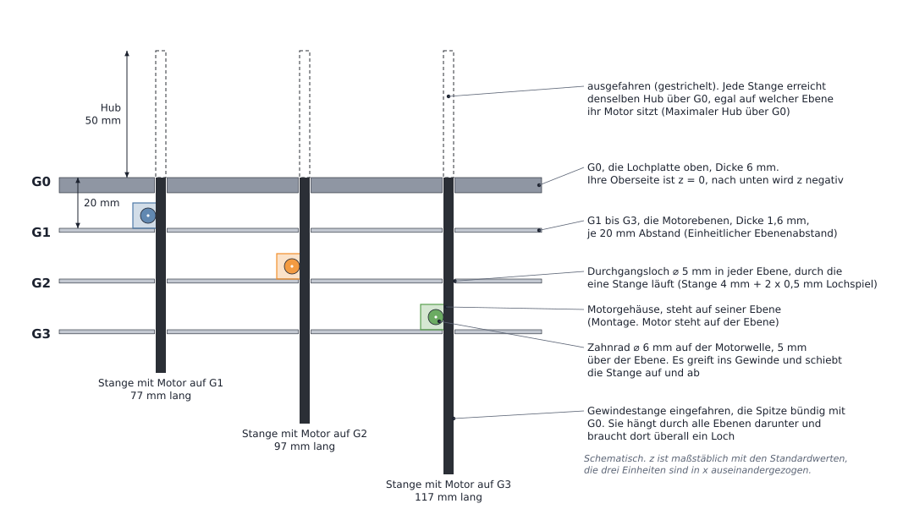

*Bild 1. Seitenschnitt durch den Stapel mit drei Einheiten, je eine Einheit mit Motor auf G1, G2 und G3. Die Höhen sind
maßstäblich, die Einheiten sind zur Übersicht in x auseinandergezogen.*

- Die Koordinaten sind fest. x zeigt nach rechts, y nach hinten (in der Draufsicht nach oben), z nach oben. Der Ursprung (0, 0)
  liegt unten links auf der Platte, z = 0 ist die Oberseite von G0. Alles unter G0 hat negative z Werte
- G0 ist mit 6 mm Standarddicke die dickste Platte. Sie führt die Stangen oben und ist die Referenz für den Hub
- Die Motorebenen G1, G2, G3 liegen standardmäßig je 20 mm auseinander, ihre Oberseiten also bei z = -20, -40 und -60. Sie
  sind 1,6 mm dick, so dick wie eine übliche Leiterplatte
- Die Ebenenabstände lassen sich auf drei Arten angeben (Feld Abstandsmodus). Einheitlicher Abstand für alle, Einzelabstände
  G0 zu G1, G1 zu G2 und so weiter, oder der Abstand jeder Ebene zu G0
- Ein Motor steht auf der Oberseite seiner Ebene (Montage. Motor steht auf der Ebene) oder hängt unter ihr (Motor hängt unter
  der Ebene). Seine Welle liegt waagerecht, das Zahnrad sitzt auf der Welle neben der Stange

### 3.2 Eine Einheit aus Stange, Motor und Zahnrad

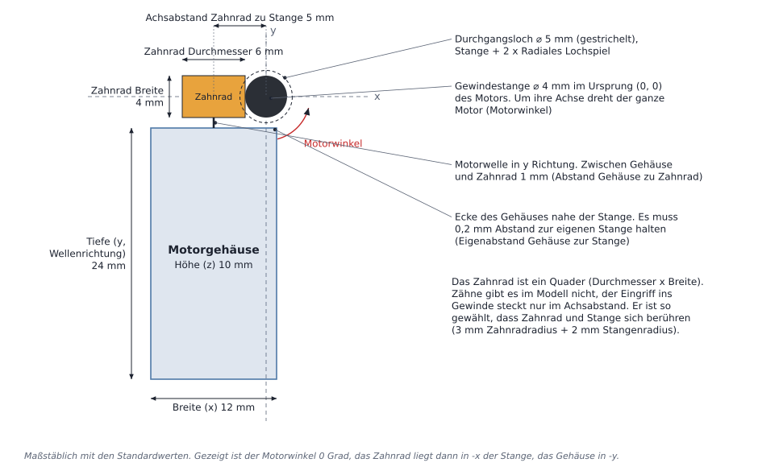

*Bild 2. Ein Motor von oben, maßstäblich mit den Standardwerten. Jeder Motor wird in seinem eigenen Rahmen beschrieben, dessen
Ursprung die eigene Stange ist.*

So beschreibt das Programm einen Motor.
- Die Stange steht im Ursprung. Um sie herum ist das Durchgangsloch gestrichelt. Es ist so groß wie die Stange plus zweimal das
  Radiale Lochspiel, mit den Standardwerten 4 + 2 x 0,5 = 5 mm
- Das Zahnrad liegt bei Motorwinkel 0 Grad links der Stange (in -x), sein Mittelpunkt im Achsabstand von der Stangenachse
  entfernt. Standard sind 5 mm, also Zahnradradius 3 mm plus Stangenradius 2 mm, Zahnrad und Stange berühren sich gerade
- Von oben ist das Zahnrad ein Rechteck aus Zahnrad Durchmesser (in x) und Zahnrad Breite (in y). Die Welle zeigt in y Richtung
- Hinter dem Zahnrad sitzt das Gehäuse, getrennt durch den Abstand Gehäuse zu Zahnrad (Standard 1 mm). Das Gehäuse ist Breite
  (x) mal Tiefe (y, Wellenrichtung) groß und Höhe (z) hoch
- Die Standardwerte sind ein N20 Getriebemotor mit Hall Encoder. Getriebe und Motor sind 12 x 10 mm im Querschnitt und ohne
  Welle 32 mm lang (Getriebe 9 mm, Motor 15 mm, Encoder etwa 8 mm). Die Welle ist 3 mm dick, etwa 10 mm lang und sitzt in der
  Mitte der Getriebefront. Der Encoder steht je nach Hersteller etwas über den Querschnitt hinaus, am echten Motor nachmessen
- Die Welle liegt in der Achshöhe über Montagefläche, Standard 5 mm über der Ebene. Auf dieser Höhe greift das Zahnrad in die Stange
- Der Motorwinkel dreht alles gemeinsam um die Stange. Das Programm probiert Winkel im Winkelschritt (Standard 15 Grad) zwischen
  Winkel von und Winkel bis
- Statt eines Rechtecks kann das Gehäuse beliebig gezeichnet werden (Schritt Motor, Ansicht Skizze, Abschnitt 9.3). Das
  Programm nimmt dann die konvexe Hülle der Zeichnung

### 3.3 Wie lang jede Stange sein muss

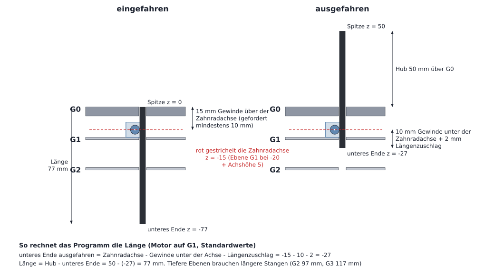

*Bild 3. Die Stange der Einheit auf G1 eingefahren und ausgefahren, mit der Rechnung der Länge.*

Die Länge jeder Stange folgt aus vier Angaben, die alle im Schritt Grundlagen stehen.
1. Hub über G0. Jede Stange muss bis 50 mm über G0 ausfahren, egal auf welcher Ebene ihr Motor sitzt
2. Gewinde unter Zahnradachse (ausgefahren). Ganz ausgefahren muss unter dem Zahnrad noch so viel Gewinde stehen, Standard 10 mm
3. Längenzuschlag. Ein Sicherheitszuschlag, Standard 2 mm
4. Spitze eingefahren unter G0. Wie tief die Spitze ganz eingefahren unter der Oberseite von G0 liegt, Standard 0 (bündig)

Die Rechnung für den Motor auf G1 lautet.

```
Zahnradachse              = Ebene G1 + Achshöhe          = -20 + 5       = -15
unteres Ende ausgefahren  = Achse - Gewinde - Zuschlag   = -15 - 10 - 2  = -27
Länge                     = Hub - unteres Ende           = 50 - (-27)    = 77 mm
unteres Ende eingefahren  = Spitze eingefahren - Länge   = 0 - 77        = -77
Gewinde über der Achse eingefahren = Spitze - Achse      = 0 - (-15)     = 15 mm (gefordert 10)
```

Jede tiefere Ebene braucht eine längere Stange. Das Programm zeigt das im Schritt Grundlagen in der Tabelle Berechnete
Ebenen und Stangenlängen.

| Ebene | z oben [mm] | Stange gesamt | unter Montage | Gewinde unten / oben |
|---|---|---|---|---|
| G0 | 0 | Referenzebene, Hub 50 mm darüber | | |
| G1 | -20 | 77 | 7 | 12 / 15 |
| G2 | -40 | 97 | 7 | 12 / 35 |
| G3 | -60 | 117 | 7 | 12 / 55 |

- Stange gesamt ist die Länge der Stange
- unter Montage ist, wie weit die ausgefahrene Stange unter die Montagefläche ihres Motors reicht
- Gewinde unten / oben ist das tatsächliche Gewinde unter der Achse ausgefahren (10 + 2 Zuschlag) und über der Achse eingefahren

Ist ein Wert zu klein oder passt ein Motor nicht zwischen zwei Platten, erscheint unter der Ebene eine rote Zeile mit dem Grund.

### 3.4 Welche Ebene welche Löcher braucht

Eine Stange braucht in jeder Platte ein Loch, die sie irgendwann während ihres Hubs berührt. Weil eine eingefahrene Stange
nach unten durch alle Ebenen unter ihrem Motor hängen kann, brauchen tiefe Ebenen auch Löcher für Stangen, deren Motor weiter
oben sitzt. In Bild 1 hängt die Stange von G1 eingefahren bis z = -77, sie braucht also Löcher in G0, G1, G2 und G3.

Der Export Schraubenpositionen ordnet jede Stange je Ebene in eine von vier Gruppen.

| Gruppe | Bedeutung |
|---|---|
| `always_present` | Die Stange steckt in jeder Stellung in dieser Ebene, das Loch ist immer belegt |
| `present_when_retracted` | Nur eingefahren, typisch für Ebenen unter dem Motor |
| `present_when_extended` | Nur ausgefahren |
| `present_during_travel` | Nur zwischen den Endlagen, selten |

### 3.5 Wann zwei Teile kollidieren

- Jede Einheit besteht für die Prüfung aus drei Körpern. Gehäuse (Quader oder gezeichnete Kontur mit Höhe), Zahnrad (Quader als
  Hülle) und Stange (Zylinder über den ganzen Verfahrweg, von eingefahren bis ausgefahren)
- Zwei Körper verschiedener Einheiten müssen im Raum mindestens Sicherheitsabstand plus Toleranz voneinander entfernt sein,
  Standard 1,05 mm. Das gilt auch gegenüber Hindernissen und dem Plattenrand
- Das eigene Zahnrad darf die eigene Stange berühren, das ist der gewollte Eingriff
- Das Gehäuse muss den Eigenabstand Gehäuse zur Stange (Standard 0,2 mm) zur eigenen Stange halten
- Motor und Zahnrad müssen senkrecht zwischen ihre Ebene und die nächste Platte passen
- Weil die Stange als Zylinder über den ganzen Weg zählt, stößt die Stange einer tiefen Ebene auch an Motoren auf Ebenen
  darüber. Das ist absichtlich vorsichtig gerechnet

### 3.6 Der Antrieb im Detail

Die Software modelliert das Zahnrad nur als Quader mit Achsabstand. Für das Verständnis der Idee ist trotzdem wichtig, was
mechanisch passiert, weil daraus Grenzen folgen.
- Das Zahnrad greift von außen in das Gewinde der Stange. Die Stange wirkt dabei wie eine Zahnstange, deren Zähne die
  Gewindegänge sind. Dreht der Motor, schiebt das Zahnrad die Stange um seinen Umfang weiter. Die Geschwindigkeit hängt nur
  vom Zahnradradius und der Drehzahl ab, v = 2 π r n. Bei r = 3 mm und 64 Umdrehungen pro Minute sind das 20 mm pro Sekunde
- Die Gewindegänge sind um den Steigungswinkel schräg, bei metrischen Gewinden etwa 3 bis 4 Grad. Das Zahnrad muss deshalb
  schräge Zähne mit genau diesem Winkel haben (ein Schneckenrad, am besten mit dem gleichen Gewinde gefräst), oder seine Achse
  muss um diesen Winkel geneigt sein
- Die Stange soll sich dabei nicht mitdrehen. Der kleine Steigungswinkel sorgt meist schon dafür, dass das Zahnrad die Stange
  nicht in Drehung versetzt (Selbsthemmung der Schnecke), bei Vibration ist eine Verdrehsicherung trotzdem sinnvoll. Die
  Verschiebung nach oben und unten ist dagegen nicht selbsthemmend.
  Drückt eine Last von oben auf die Stange, wird sie über das Zahnrad direkt in den Motor zurückgeleitet. Gehalten wird die Last
  nur vom Getriebe des Motors, von einer Bremse oder von der Regelung über den Encoder
- Die 60 Grad Flanken eines metrischen Gewindes drücken Zahnrad und Stange unter Last auseinander. Eine Führung oder Rolle
  gegenüber dem Zahnrad hält die Stange im Eingriff

Diese Punkte ändern nichts an der Geometrie, die das Programm rechnet. Sie entscheiden aber über Motor, Gewinde und Zahnradform.

## 4. Warum mehrere Ebenen

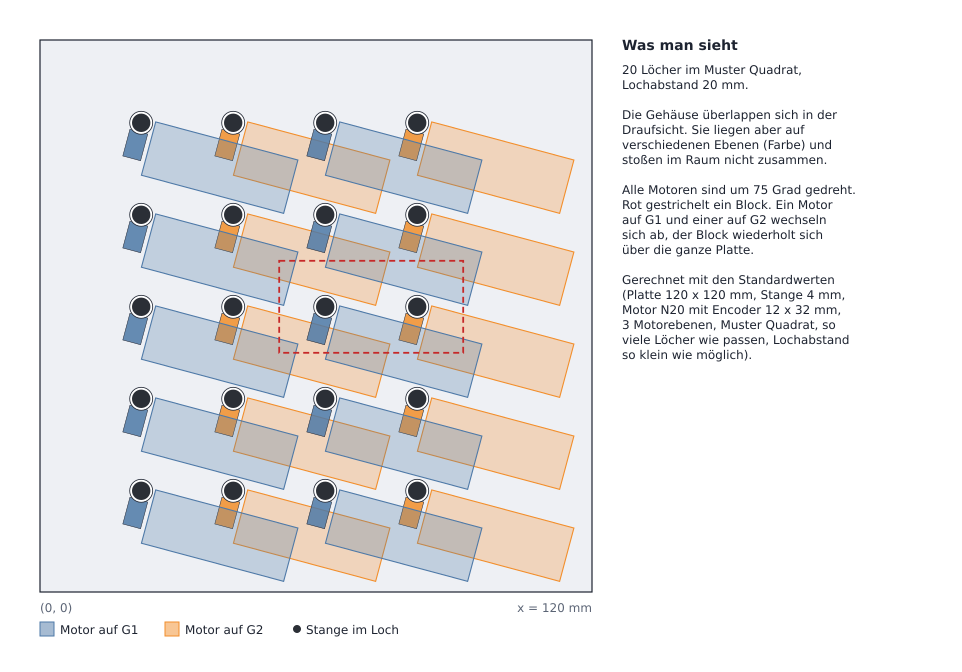

*Bild 4. Ein echtes Ergebnis mit den Standardwerten im Muster Quadrat. Blau die Motoren auf G1, orange die auf G2.*

Bild 4 zeigt den Kern der Idee.
- 20 Löcher stehen im Quadrat mit 20 mm Lochabstand auf der Platte 120 x 120 mm
- Jeder Motor ist ein N20 mit Encoder, 12 x 32 mm groß und um 75 Grad gedreht. In der Draufsicht überlappen sich blaue und orange Gehäuse
  deutlich. Sie liegen aber 20 mm übereinander und berühren sich im Raum nicht
- Zwei Motoren gleicher Ebene überlappen sich dagegen nie. Deshalb wechseln G1 und G2 sich ab
- Der rot gestrichelte Block enthält ein Loch mit Motor auf G1 und eines mit Motor auf G2. Dieser Block wiederholt sich über
  die ganze Platte

Mit nur einer Motorebene findet das Programm bei denselben Werten 27 mm Lochabstand und 16 Löcher statt 20 mm und 20 Löcher.
Der Gewinn hängt stark von der Motorform ab. Je größer der Motor im Verhältnis zur Stange, desto mehr bringen weitere Ebenen.
Die dritte Ebene wird hier gar nicht gebraucht, das Ergebnis nutzt 2 von 3 Ebenen. Am rechten Rand bleibt eine Spalte frei, weil
die langen Motoren dort in ihrer festen Ausrichtung über die Platte ragen würden.

## 5. Platte, Sperrrand, Randbereich und Lochbereich

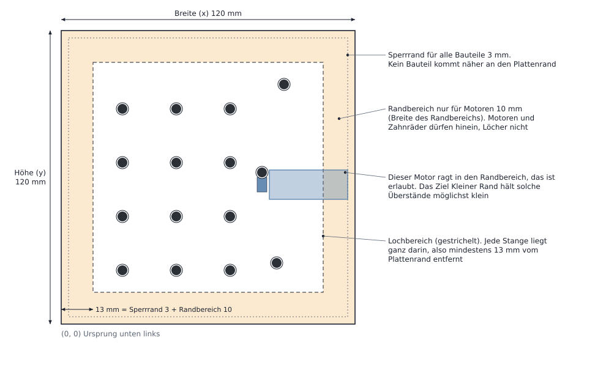

*Bild 5. Platte 120 x 120 mm mit 3 mm Sperrrand und 10 mm Randbereich. Der Lochbereich beginnt 13 mm vom Plattenrand.*

- Die Platte ist ein Rechteck aus Breite (x) und Höhe (y), Standard 120 x 120 mm, Ursprung unten links
- Sperrrand für alle Bauteile. Kein Bauteil kommt näher an den Plattenrand, Standard 0 mm
- Randbereich nur für Motoren (Schalter) mit Breite des Randbereichs (Standard 10 mm). In diesen Streifen dürfen Motoren und
  Zahnräder ragen, aber keine Stange. Die Löcher bleiben im Lochbereich
- Lochbereich. Der innere Teil, um Sperrrand plus Randbereich vom Plattenrand entfernt. Jede Stange liegt ganz darin
- Über den Plattenrand ragen dürfen. Standard ist keine Bauteile. Mit Motoren und Zahnräder dürfen Motoren über die Platte
  hinaus, nur die Stangen müssen auf der Platte liegen
- Hindernisse und Sperrzonen. Rechtecke oder Kreise, die frei bleiben müssen. Ohne Ebene gelten sie für alle Ebenen, mit Ebene
  nur für den Motorraum dieser Ebene (zum Beispiel eine Schraube oder ein Stecker)
- Montagebereiche je Ebene. Rechtecke, in denen die Gehäuse einer Ebene vollständig liegen müssen. Ohne Eintrag gilt die ganze Platte

## 6. Die drei Modi

Im Schritt Modus wird festgelegt, was berechnet wird. Technisch wählt der Modus den Optimierer.

| Modus in der Oberfläche | Optimierer | Was das Programm tut |
|---|---|---|
| Löcher vorgeben | `fixed_holes` | Du setzt die Löcher selbst. Für jedes Loch sucht das Programm Ebene, Motorwinkel und Achsabstand oder sagt, warum es nicht geht |
| Muster wählen, Löcher und Motoren wiederholen sich (2a) | `periodic_tile` | Die Löcher bilden ein Muster, die Motoranordnung wiederholt sich als Block |
| Muster wählen, nur die Löcher (2b) | `pattern_holes` | Die Löcher bilden ein Muster, jeder Motor wird einzeln gedreht |
| Frei verteilen (unter Weitere Modi) | `pattern_greedy`, `anneal_free`, `exhaustive_small` | Ohne festes Muster möglichst viele Stangen unterbringen |

### 6.1 Löcher vorgeben

- Die Löcher stehen auf G0 und werden im Schritt Löcher eingegeben. Als Tabelle, aus Text oder Excel eingefügt (ein Loch je
  Zeile, x und y getrennt durch Semikolon, Komma, Leerzeichen oder Tabulator), mit einem Muster gefüllt, durch Klick in die
  Vorschau gesetzt oder als Datei geladen. In der Vorschau verschiebt Ziehen ein Loch, Rechtsklick löscht es
- Schon beim Eingeben prüft das Programm, ob ein Loch außerhalb des Lochbereichs liegt oder zwei Löcher zu nah beieinander sind
- Die Suche ist exakt. Sie beginnt mit dem Loch, das die wenigsten Möglichkeiten hat, und streicht nach jeder Wahl die
  Möglichkeiten der Nachbarn, die damit kollidieren. Endet sie ohne Lösung und ohne an ein Zeitlimit zu stoßen, ist bewiesen,
  dass nicht alle Löcher gleichzeitig bedient werden können
- Geht es nicht vollständig, liefert das Programm die größte gefundene Menge bedienter Löcher und nennt für jedes übrige Loch den
  Grund. Zum Beispiel außerhalb des Bauraums, kollidiert mit den bedienten Löchern 3, 4 und 8, oder Kapazität der Ebenen erschöpft
- Nach der ersten gültigen Lösung verbessert eine eigene Phase die Ziele (Abschnitt 7)

### 6.2 Muster wählen

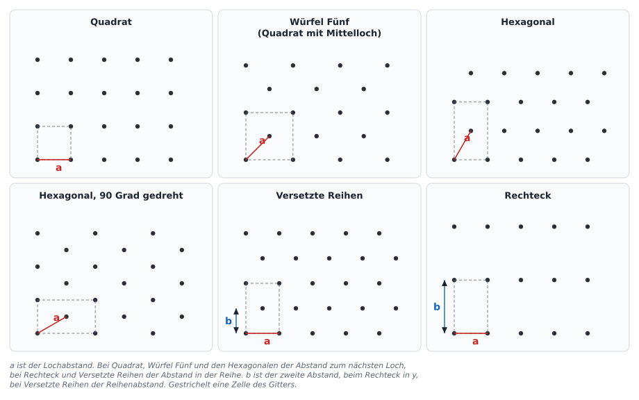

*Bild 6. Die Musterformen mit Lochabstand a (rot) und zweitem Abstand b (blau).*

Die Musterform wird als Bildkarte gewählt.

| Karte | Lochbild | Abstände |
|---|---|---|
| Quadrat | Quadratisches Gitter | a in x und y |
| Würfel Fünf (Quadrat mit Mittelloch) | Quadrat mit einem Loch in jeder Mitte | a zu den vier nächsten Löchern |
| Hexagonal | Dichteste Kreispackung, Reihen in x | a zu allen sechs Nachbarn |
| Hexagonal, 90 Grad gedreht | Wie Hexagonal, Reihen in y | a zu allen sechs Nachbarn |
| Versetzte Reihen | Jede zweite Reihe um a/2 verschoben | a in der Reihe, Reihenabstand b. Leer heißt dicht wie Kreise (b = 0,866 a) |
| Rechteck | Rechteckiges Gitter | a in x, b in y. Leer heißt b = a |
| Eigene Kachel (Lochbild Datei) | Eine selbst gezeichnete Kachel, die sich wiederholt | Wie gezeichnet, fest oder skalierbar |
| Frei (Schrauben je Kachel) | Ältere Variante. Eine Kachel mit einigen Schrauben, deren Lage frei gesucht wird | Kachelbreite und Kachelhöhe getrennt |

Danach beantwortest du zwei Fragen.

| Frage | Antworten |
|---|---|
| Wie viele Löcher? | So viele wie auf die Platte passen, oder Genau diese Anzahl (dann erscheint das Feld Anzahl Löcher) |
| Welcher Lochabstand? | So klein wie möglich, So groß wie möglich (verteilt), oder Fester Abstand (dann erscheint das Feld Lochabstand) |

Die Kombinationen bedeuten Folgendes.

| Wie viele | Welcher Abstand | Ergebnis |
|---|---|---|
| So viele wie passen | So klein wie möglich | Dichtestes Muster über die ganze Platte (Standard) |
| Genau N | So klein wie möglich | N Löcher so dicht wie möglich in der Mitte der Platte |
| Genau N | So groß wie möglich | N Löcher gleichmäßig über die ganze Platte verteilt |
| So viele wie passen | Fester Abstand | Die Platte mit genau diesem Abstand füllen |
| Genau N | Fester Abstand | N Löcher mit genau diesem Abstand in der Mitte |
| So viele wie passen | So groß wie möglich | Nicht möglich und ausgegraut. Ohne feste Anzahl hat größter Abstand keinen Sinn |

- Lochabstände werden auf dem Musterraster gesucht (Standard 0,5 mm). Der gefundene kleinste Abstand ist der kleinste auf
  diesem Raster und nicht mathematisch als kleinster bewiesen. Das steht auch im Ergebnis
- Bei Genau N mit kleinem oder festem Abstand liegen die Löcher in der Mitte der Platte

### 6.3 Was wiederholt sich, 2a und 2b

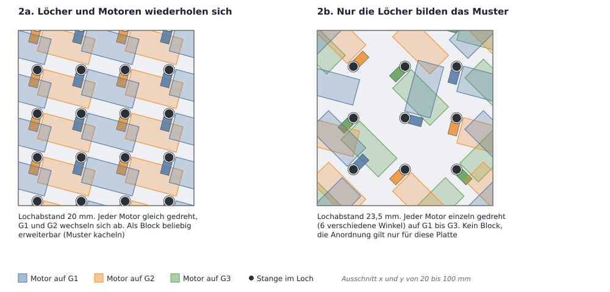

*Bild 7. Links 2a, rechts 2b, beide mit den Standardwerten im Quadrat gerechnet. Gezeigt ist ein Ausschnitt.*

Unter der Musterform steht die Frage Was wiederholt sich?
- Löcher und Motoren, als Block beliebig erweiterbar (2a). Das Programm sucht einen kleinen Block aus Zellen des Gitters, in dem
  jedes Loch Ebene, Motorwinkel und Achsabstand bekommt. Der Block wird gegen alle seine Kopien in Reichweite geprüft. Ist er
  kollisionsfrei, ist das ganze unendliche Gitter gültig und jede Teilmenge davon auch. Blöcke werden nach Lochzahl aufsteigend
  probiert, höchstens Größter Wiederholblock Löcher (Standard 12). Vorteil. Alle Motoren sind gleich ausgerichtet, das Ergebnis
  lässt sich kacheln (Abschnitt 9.9), und es sieht aufgeräumt aus
- Nur die Löcher, jeder Motor einzeln gedreht (2b). Die Löcher liegen im Muster, aber jeder Motor bekommt eigene Ebene und eigenen
  Winkel, wie bei vorgegebenen Löchern. Das ist flexibler, die Anordnung gilt aber nur für diese Platte. Mit den Standardwerten
  findet 2b 23,5 mm Lochabstand mit Motoren auf G1 bis G3 und vier verschiedenen Winkeln, 2a dagegen 20 mm. Dafür bringt 2b
  25 Löcher unter und 2a nur 20, weil 2a am Rand Löcher weglässt, deren Motor in der festen Ausrichtung nicht mehr auf die
  Platte passt. Welche Variante besser abschneidet, hängt von Motor, Muster und Platte ab

### 6.4 Frei verteilen

Unter Weitere Modi steht Frei verteilen. Hier gibt es kein festes Lochbild, das Programm bringt möglichst viele Stangen
unter. Drei Verfahren stehen zur Wahl.

| Verfahren | Arbeitsweise | Aussage |
|---|---|---|
| Muster und lokale Suche | Quadrat und Hexagonalraster, Teilung gesucht, danach lokale Suche (Simulated Annealing) | beste gefundene Lösung |
| Freie Verteilung (Annealing) | Freie Lage mit mehreren Starts | beste gefundene Lösung |
| Exakt auf Raster (kleine Aufgaben) | Vollständige Suche auf einem Raster, bis etwa 14 Stangen | bewiesen, aber nur bezogen auf das Raster |

Das Anordnungsziel entscheidet zwischen Kompakt (kleine Grundfläche) und Verteilt über den Bauraum. Das Feld Gewünschte
Anzahl Stangen gibt an, wie viele es werden sollen.

## 7. Ziele und Prozente

Im Schritt Ziele und Berechnen steht die Frage Was ist dir wichtig? Jedes Ziel hat einen Regler und ein Zahlenfeld von 0 bis
100 Prozent. Zusammen müssen sie 100 Prozent ergeben. Darunter steht die Summe in Grün bei genau 100, sonst in Orange mit es
fehlen x Prozent oder x Prozent zu viel. Der Knopf Auf 100 % bringen verteilt den Rest im gleichen Verhältnis. Erst bei 100
Prozent lässt sich die Berechnung starten.

Welche Ziele erscheinen, hängt vom Modus ab.

| Ziel | Modi | Bedeutung | Standard |
|---|---|---|---|
| Kleiner Rand | Löcher und Muster | Motoren ragen möglichst wenig in den Randbereich. Wirkt nur mit eingeschaltetem Randbereich, sonst steht ein Hinweis daneben | 50 % |
| Saubere Ausrichtung | Löcher und Muster | Benachbarte Löcher entlang der zwei Hauptrichtungen des Gitters haben möglichst gleiche Ebene und gleichen Winkel. Reihenweise abwechselnd zählt auch als sauber | 50 % |
| Wenig Ebenen | alle, nur wenn die Anzahl der Ebenen nicht fest ist | Motoren möglichst auf die oberen Ebenen, damit weniger Platten nötig sind | 0 % |
| Anzahl Stangen | Frei verteilen | Platzierte Anzahl im Verhältnis zur gewünschten Anzahl | 48 % |
| Kleine Grundfläche | Frei verteilen | Kleine umschließende Fläche der Anordnung | 38 % |
| Gleichmäßige Verteilung | Frei verteilen | Ähnliche Abstände zum nächsten Nachbarn | 10 % |
| Regelmäßiges Muster | Frei verteilen | Ordnung wie Quadrat oder Hexagon | 4 % |

So werden die Ziele verrechnet.
- In den Modi Löcher und Muster zählt jedes bediente Loch mehr als alle Ziele zusammen. Der Gesamtwert ist
  (Anzahl bedienter Löcher + gewichtete Ziele) / (Zielanzahl + 1). Erst wenn gleich viele Löcher bedient sind, entscheiden die Ziele
- Jedes Ziel ist eine Zahl von 0 bis 1. Die Prozente gewichten sie
- Voreinstellungen setzen typische Mischungen. In den Modi Löcher und Muster Kleiner Rand (70 % Rand), Saubere Ausrichtung
  (70 % Ausrichtung), Wenig Ebenen (60 % Ebenen, nur bei nicht fester Anzahl) und Ausgewogen. Beim freien Verteilen Viele Stangen,
  Kleine Fläche, Gleichmäßig und Ausgewogen

## 8. Ebenen fest oder nicht fest

Im Schritt Grundlagen steht unter Anzahl Motorebenen der Schalter Anzahl Ebenen fest.
- An (Standard). Es gibt genau so viele Ebenen. Motoren dürfen auf jede
- Aus. Höchstens so viele Ebenen. Das Ziel Wenig Ebenen erscheint, die Suche probiert obere Ebenen zuerst, und Ergebnis, Prüfung
  und Export enthalten nur die tatsächlich genutzten Ebenen G1 bis Gk mit den passenden Stangenlängen und Lochlisten. Werden
  nur G1 und G2 gebraucht, entfällt G3 samt ihren Löchern

## 9. Die Oberfläche Schritt für Schritt

Die Oberfläche läuft im Browser (Start mit `python run.py`, dann http://127.0.0.1:8765). Oben steht die Kopfzeile, darunter
die Schrittleiste mit sieben Schritten von links nach rechts. Jeder Schritt endet mit den Knöpfen Zurück und Weiter.
Springen ist jederzeit möglich, ein Klick auf einen Schritt öffnet ihn.

### 9.1 Kopfzeile und Schrittleiste

| Beschriftung | Wirkung |
|---|---|
| Beispiel laden | Lädt eine der fertigen Konfigurationen aus `examples/` |
| Standardwerte | Setzt alles auf die Standardwerte zurück (mit Rückfrage) |
| Konfig speichern | Lädt die aktuelle Konfiguration als JSON Datei herunter |
| Konfig laden | Öffnet eine gespeicherte Konfiguration |
| Sprachwahl | Deutsch, Englisch, Französisch. Wird im Browser gemerkt |
| ✓ an einem Schritt | Schon bearbeitet |
| ! an einem Schritt | Hier gibt es ein Problem. Ein Klick springt zum ersten Feld mit Fehler |
| i Knopf neben einem Feld | Öffnet eine Erklärung zu diesem Feld oder Bereich |
| Weitere Einstellungen | Eingeklappte, selten geänderte Felder. Die Zusammenfassung zeigt, wie viele davon geändert sind, ein Fehler klappt sie auf |

Fehler stehen rot direkt am Feld und zusätzlich oben in einem Hinweisband. Fehler der Motor Skizze stehen in der Skizze und als
! am Schritt Motor.

### 9.2 Schritt 1 Grundlagen

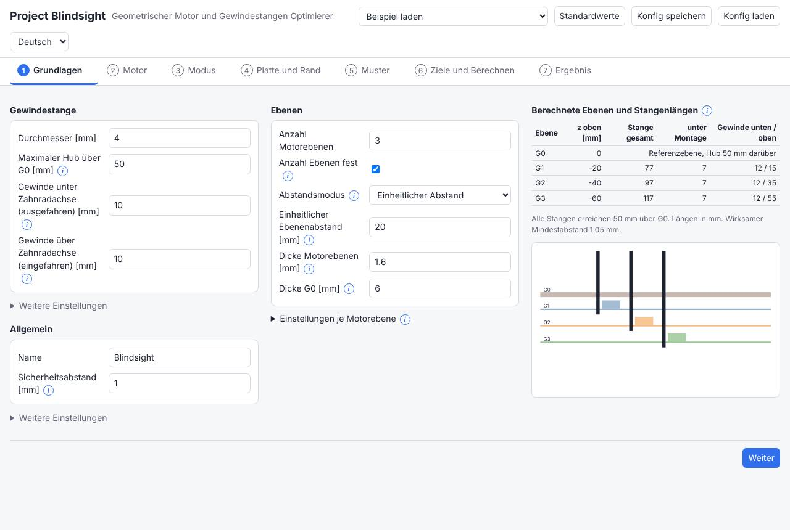

Gewindestange

| Beschriftung | Bedeutung | Standard | Wo |
|---|---|---|---|
| Durchmesser [mm] | Außendurchmesser des Gewindes | 4 mm | sichtbar |
| Maximaler Hub über G0 [mm] | So weit muss jede Stange oberhalb von G0 ausfahren können, unabhängig von der Motorebene | 50 mm | sichtbar |
| Gewinde unter Zahnradachse (ausgefahren) [mm] | Mindestgewinde unter der Zahnradachse bei maximalem Ausfahren | 10 mm | sichtbar |
| Gewinde über Zahnradachse (eingefahren) [mm] | Mindestgewinde über der Zahnradachse bei vollem Einfahren | 10 mm | sichtbar |
| Längenzuschlag [mm] | Zusätzlicher Sicherheitszuschlag der Stangenlänge | 2 mm | Weitere Einstellungen |
| Spitze eingefahren unter G0 [mm] | Tiefe der Stangenspitze unter G0 bei vollem Einfahren (0 = bündig) | 0 mm | Weitere Einstellungen |
| Radiales Lochspiel [mm] | Spiel der Durchgangslöcher in den Ebenen je Seite | 0,5 mm | Weitere Einstellungen |

Allgemein

| Beschriftung | Bedeutung | Standard | Wo |
|---|---|---|---|
| Name | Bezeichnung des Projekts | Blindsight | sichtbar |
| Sicherheitsabstand [mm] | Mindestabstand zwischen allen fremden Bauteilen | 1 mm | sichtbar |
| Toleranz [mm] | Wird zum Sicherheitsabstand addiert (Fertigung, Rundung) | 0,05 mm | Weitere Einstellungen |

Ebenen

| Beschriftung | Bedeutung | Standard |
|---|---|---|
| Anzahl Motorebenen | Anzahl der Ebenen G1 bis Gn, keine feste Obergrenze | 3 |
| Anzahl Ebenen fest | An heißt genau so viele, aus heißt höchstens so viele (Abschnitt 8) | an |
| Abstandsmodus | Einheitlicher Abstand, Einzelabstände G(i) zu G(i+1), oder Abstand jeder Ebene zu G0. Je nach Wahl erscheint nur das passende Feld | Einheitlicher Abstand |
| Einheitlicher Ebenenabstand [mm] | Abstand zwischen allen Ebenen | 20 mm |
| Einzelabstände (Liste) | Abstände G0 zu G1, G1 zu G2 und so weiter, mit Komma getrennt | leer |
| Abstände zu G0 (Liste) | Abstand jeder Motorebene zu G0, aufsteigend | leer |
| Dicke Motorebenen [mm] | Plattendicke der Ebenen G1 bis Gn | 1,6 mm |
| Dicke G0 [mm] | Plattendicke der oberen Referenzebene | 6 mm |

Einstellungen je Motorebene (eingeklappt) ist eine Tabelle mit einer Zeile je Ebene. Spalten erlaubt (darf diese Ebene Motoren
tragen), max. Motoren (Obergrenze der Motoren auf dieser Ebene), Winkel (Grad) (nur diese Winkel auf dieser Ebene, mit Komma)
und Dicke [mm] (eigene Plattendicke). Leer lassen heißt Standard.

Rechts steht Berechnete Ebenen und Stangenlängen mit der Tabelle aus Abschnitt 3.3 und einem kleinen Seitenschnitt mit einer
Stange und einem Motor je Ebene. Darunter der Satz Alle Stangen erreichen 50 mm über G0 und der wirksame Mindestabstand 1,05 mm.

### 9.3 Schritt 2 Motor

Der Schritt hat oben den Umschalter Maße und Skizze.

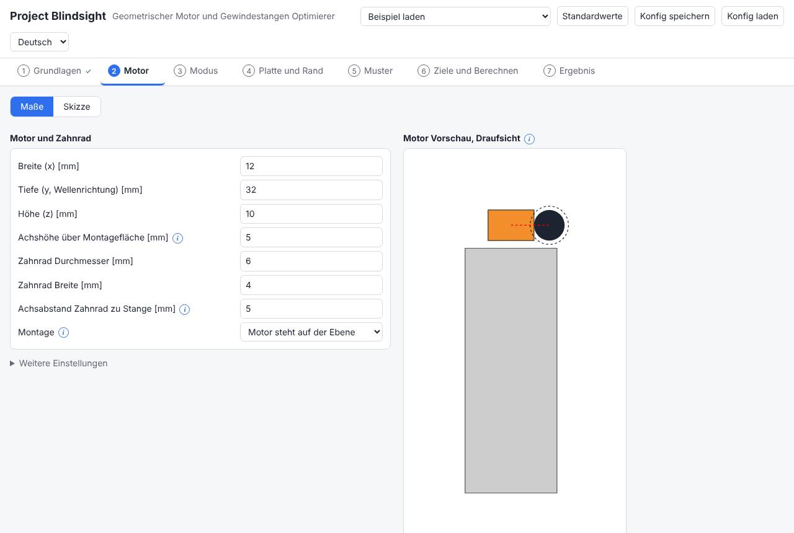

Maße

| Beschriftung | Bedeutung | Standard | Wo |
|---|---|---|---|
| Breite (x) [mm] | Gehäusebreite quer zur Welle | 12 mm | sichtbar |
| Tiefe (y, Wellenrichtung) [mm] | Gehäusetiefe entlang der Welle (N20 mit Encoder, ohne Welle) | 32 mm | sichtbar |
| Höhe (z) [mm] | Gehäusehöhe senkrecht zur Ebene | 10 mm | sichtbar |
| Achshöhe über Montagefläche [mm] | Höhe der Welle über der Montagefläche | 5 mm | sichtbar |
| Zahnrad Durchmesser [mm] | Außendurchmesser des Zahnrads | 6 mm | sichtbar |
| Zahnrad Breite [mm] | Axiale Breite des Zahnrads | 4 mm | sichtbar |
| Achsabstand Zahnrad zu Stange [mm] | Abstand der Welle zur Stangenachse, darüber ist der Eingriff modelliert | 5 mm | sichtbar |
| Montage | Motor steht auf der Ebene, oder Motor hängt unter der Ebene | steht auf der Ebene | sichtbar |
| Abtriebsachse, x Versatz [mm] | Seitlicher Versatz der Welle zur Gehäusemitte | 0 mm | Weitere Einstellungen |
| Abstand Gehäuse zu Zahnrad [mm] | Axialer Abstand zwischen Gehäusekante und Zahnrad | 1 mm | Weitere Einstellungen |
| Achsabstand min (optional) [mm] | Untergrenze, wenn das Programm den Achsabstand verändern darf | leer | Weitere Einstellungen |
| Achsabstand max (optional) [mm] | Obergrenze dazu | leer | Weitere Einstellungen |
| Achsabstand Stufen | Stufen zwischen min und max, 1 heißt nur der Nennwert | 1 | Weitere Einstellungen |
| Eigenabstand Gehäuse zur Stange [mm] | Mindestabstand des Gehäuses zur eigenen Stange | 0,2 mm | Weitere Einstellungen |

Rechts zeigt Motor Vorschau, Draufsicht den Motor mit der Stange im Ursprung (schwarz), dem Loch gestrichelt, dem Zahnrad orange
und dem Gehäuse grau. Darunter
- Kontur in der Motor Skizze bearbeiten. Wechselt zur Skizze
- SVG Import. Liest eine Motorkontur aus einer SVG Datei (genau ein Rechteck, Polygon oder Pfad aus Geraden). Ist der Maßstab
  nicht eindeutig, fragt das Programm nach. Das Ergebnis ist eine Skizze
- Motor Bibliothek (lokal im Browser). Motoren unter einem Namen speichern, laden, löschen, als JSON exportieren und importieren

Gibt es eine Skizze, steht hier Die Form kommt aus der Motor Skizze mit dem Knopf Skizze verwerfen. Breite, Tiefe, Zahnrad und
Achsabstand sind dann gesperrt und werden aus der Skizze übernommen.

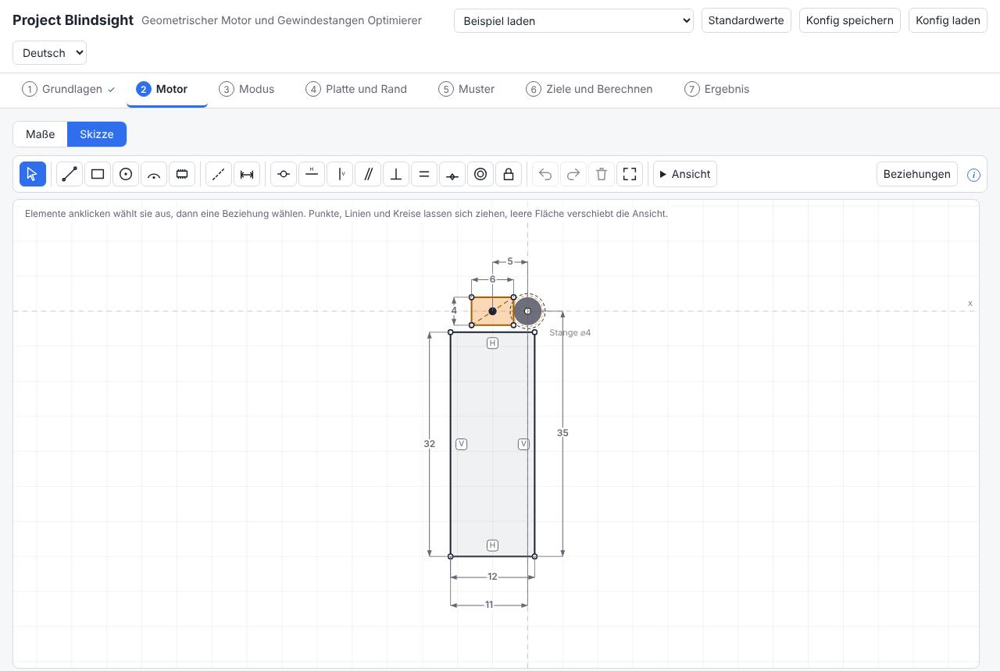

Skizze. Der Motor wird von oben gezeichnet wie in einem CAD Programm (Onshape). Die Stange ist der Ursprung.
- Werkzeugleiste von links. Auswahl (S), Linie (L), Rechteck (R), Kreis (C), Bogen (A), Zahnrad (G), Konstruktion (Q),
  Bemaßung (D), dann die Beziehungen Koinzident (I), Horizontal (H), Vertikal (V), Parallel, Senkrecht, Gleich (E), Mittelpunkt,
  Konzentrisch und Fixieren, dann Rückgängig, Wiederholen, Löschen und Einpassen (F). Rechts Ansicht (Drehvorschau, Hüllkurve,
  Gehäusehülle, Raster) und Beziehungen (die Liste aller Beziehungen und Maße)
- Beim Zeichnen rastet der Mauszeiger auf Punkte, Linien und das Raster ein. Fast waagerechte Linien bekommen Horizontal, fast
  senkrechte Vertikal
- Maße setzt man mit Bemaßung. Element anklicken, Maßzahl platzieren, Wert eintippen. Doppelklick auf eine Maßzahl ändert sie
- Farben. Blau heißt noch frei beweglich, schwarz voll bestimmt, rot Widerspruch, orange ausgewählt
- Die Statuszeile unter der Zeichnung sagt Voll bestimmt, Unterbestimmt mit der Zahl der Freiheitsgrade, Überbestimmt oder
  Widerspruch, dazu Zahnrad und Achsabstand
- Das Gehäuse ist die konvexe Hülle aller normalen Elemente (hell gefüllt). Konstruktionslinien zählen nicht. Das Zahnrad ist
  ein Rechteck mit der Rolle Zahnrad, seine Mitte liegt auf der x Achse. Es gibt nur ein Zahnrad je Skizze
- Ohne eigene Skizze zeigt die Skizze eine Vorschau aus den Maßen. Die erste Änderung übernimmt sie in die Konfiguration

### 9.4 Schritt 3 Modus

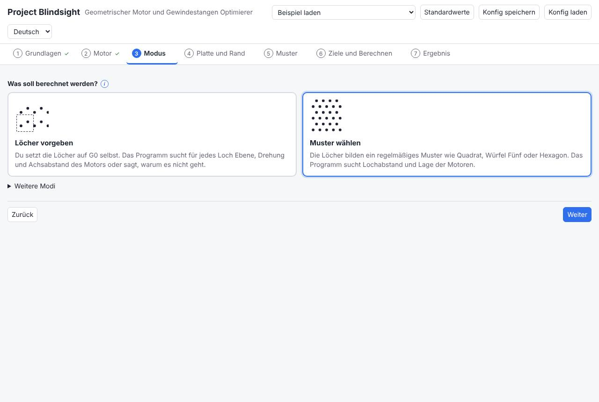

Unter Was soll berechnet werden? stehen zwei große Karten, Löcher vorgeben und Muster wählen. Eingeklappt unter Weitere Modi
steht Frei verteilen. Die gewählte Karte ist blau umrandet. Der Modus ändert den Namen von Schritt 5 (Löcher, Muster oder
Verteilung) und die Ziele in Schritt 6.

### 9.5 Schritt 4 Platte und Rand

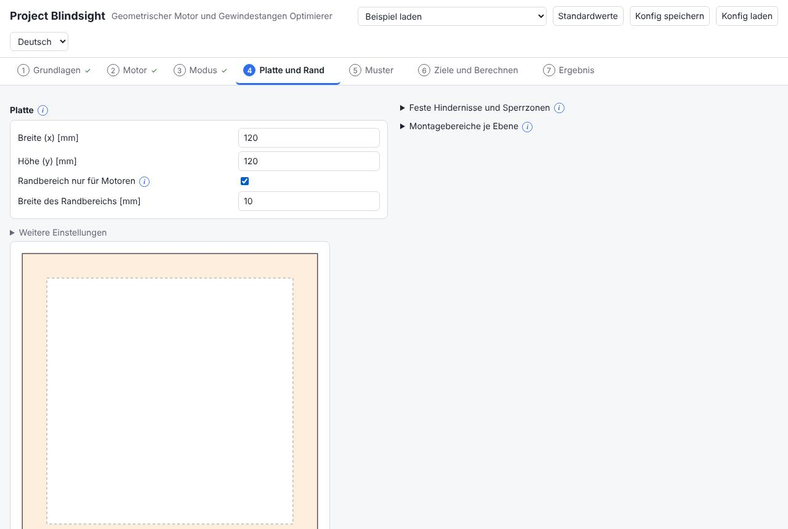

| Beschriftung | Bedeutung | Standard | Wo |
|---|---|---|---|
| Breite (x) [mm] | Ausdehnung der Platte in x ab dem Ursprung unten links | 120 mm | sichtbar |
| Höhe (y) [mm] | Ausdehnung der Platte in y | 120 mm | sichtbar |
| Randbereich nur für Motoren | Streifen am Rand nur für Motoren, die Löcher bleiben innerhalb | aus | sichtbar |
| Breite des Randbereichs [mm] | Breite dieses Streifens, erscheint nur wenn er an ist | 10 mm | sichtbar |
| Sperrrand für alle Bauteile [mm] | Zusätzlicher Abstand aller Bauteile zum Plattenrand | 0 mm | Weitere Einstellungen |
| Über den Plattenrand ragen dürfen | keine Bauteile, oder Motoren und Zahnräder | keine Bauteile | Weitere Einstellungen |

Die Vorschau darunter zeigt die Platte, gestrichelt den Lochbereich und hell den Randbereich (wie Bild 5). Rechts eingeklappt
- Feste Hindernisse und Sperrzonen. Tabelle mit Form (Rechteck oder Kreis), x, y, Breite, Höhe, Radius, Winkel, Ebene und Name.
  Ohne Ebene gilt das Hindernis über alle Ebenen, mit Ebene ist es eine Sperrzone nur für diese Motorebene
- Montagebereiche je Ebene. Tabelle mit Ebene, x min, y min, x max, y max. Gehäuse müssen ganz in einem Bereich ihrer Ebene liegen

### 9.6 Schritt 5 Löcher, Muster oder Verteilung

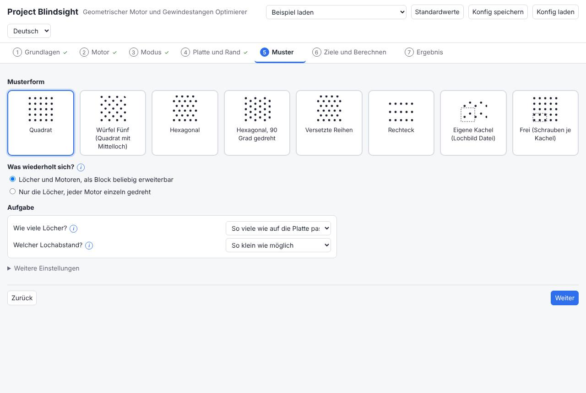

Im Modus Muster wählen steht hier
- Musterform. Die Bildkarten aus Abschnitt 6.2. Frei (Schrauben je Kachel) ist bei 2b ausgegraut, weil 2b ein Gitter braucht
- Was wiederholt sich? Die Auswahl 2a oder 2b aus Abschnitt 6.3
- Aufgabe. Die beiden Fragen und je nach Antwort die passenden Felder

| Beschriftung | Bedeutung | Standard | Wann sichtbar |
|---|---|---|---|
| Wie viele Löcher? | So viele wie auf die Platte passen, oder Genau diese Anzahl | So viele wie passen | immer |
| Welcher Lochabstand? | So klein wie möglich, So groß wie möglich (verteilt), Fester Abstand | So klein wie möglich | immer |
| Anzahl Löcher | Gewünschte Zahl der Löcher | 12 | bei Genau diese Anzahl |
| Lochabstand (optional) [mm] | Abstand zum nächsten Loch, bei eigener Kachel die Kachelbreite | leer | bei Fester Abstand |
| Zweiter Abstand (optional) [mm] | Rechteck Abstand in y, Versetzte Reihen Reihenabstand | leer | bei Rechteck und Versetzte Reihen |
| Schrauben je Kachel, Kachelbreite, Kachelhöhe | Nur für das Muster Frei | 2, leer, leer | bei Muster Frei |
| Größter Wiederholblock | Höchstens so viele Löcher hat der Block von 2a | 12 | Weitere Einstellungen, bei 2a |
| Musterraster [mm] | Raster, auf dem Abstände gesucht werden | 0,5 mm | Weitere Einstellungen |

Mit der Karte Eigene Kachel erscheint darunter der Lochbild Editor für die Kachel mit Kachelbreite, Kachelhöhe und Skalierbar.

Im Modus Löcher vorgeben steht hier der Lochbild Editor (Abschnitt 6.1) mit Tabelle, Loch hinzufügen, Alle löschen, Aus Text
einfügen (Anhängen oder Ersetzen), Mit Muster füllen (Muster, Lochabstand, Randabstand, Füllen), JSON herunterladen, JSON laden,
der Vorschau und einer Statuszeile mit gefundenen Problemen.

Im Modus Frei verteilen stehen hier Verfahren, Gewünschte Anzahl Stangen, Anordnungsziel und eingeklappt Muster (square, hex_x,
hex_y) und Feste Teilung.

### 9.7 Schritt 6 Ziele und Berechnen


- Oben fasst ein Kasten zusammen, was gerechnet wird. Zum Beispiel Muster Quadrat, Löcher und Motoren wiederholen sich, So viele
  wie auf die Platte passen, Abstand So klein wie möglich. Platte 120 x 120 mm, ohne Randbereich. 3 Motorebenen
- Was ist dir wichtig? Die Ziele aus Abschnitt 7 mit Summe, Auf 100 % bringen und Voreinstellung
- Suche. Zeitlimit (s), Standard 20. Unter Weitere Einstellungen Winkelschritt (Grad) 15, Winkel von (Grad) 0, Winkel bis (Grad,
  exklusiv) 360, Nur diese Winkel (Liste), Max. Kandidaten 2000000, Seed 1 (gleicher Seed gibt gleiches Ergebnis), Anzahl
  Lösungen 5, Anteil lokale Suche 0,35, Stagnation (s) 6 (früher aufhören, wenn das Ziel erreicht ist und sich so lange nichts
  verbessert) und Parallele Läufe 1
- Berechnung. Optimierung starten und Abbrechen, ein Fortschrittsbalken, eine Tabelle mit Zwischenständen und Beste bisherige
  Lösung als Live Vorschau. Ist die Summe der Ziele nicht 100 Prozent, ist der Start gesperrt und ein Satz sagt warum

### 9.8 Schritt 7 Ergebnis

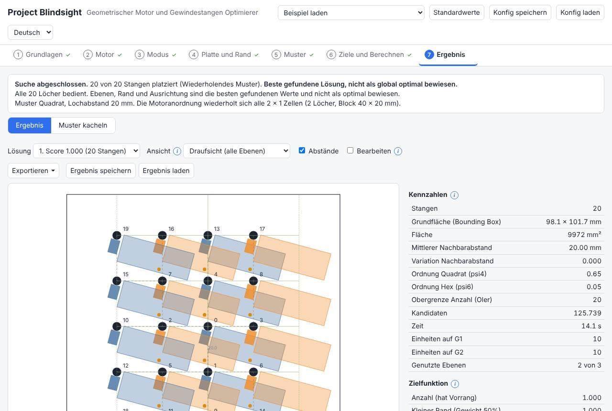

Oben steht ein Statuskasten, zum Beispiel Suche abgeschlossen. 20 von 20 Stangen platziert (Wiederholendes Muster). Beste
gefundene Lösung, nicht als global optimal bewiesen. Darunter weitere Sätze zum Muster, zum Lochabstand und zum Block. Der
Statuskasten ist rot umrandet, wenn weniger Stangen als gewünscht platziert wurden oder Kollisionen bestehen.

Mögliche Zustände sind Suche abgeschlossen, Zeitlimit erreicht, Kandidatenlimit erreicht, Abgebrochen, Keine gültige Lösung,
Beendet bei Stagnation und Manuell bearbeitet.

Umschalter Ergebnis und Muster kacheln, danach zwei Zeilen
- Lösung. Auswahl der besten Lösungen mit Score und Anzahl
- Ansicht. Draufsicht (alle Ebenen), Einzelne Ebene (mit Auswahl Ebene), Seitenschnitt, Räumlich (mit Maus drehen)
- Abstände. Blendet die Abstände zum nächsten Nachbarn ein
- Bearbeiten. Stangen in der Draufsicht ziehen, Einheiten hinzufügen oder entfernen, Ebene und Winkel eintippen. Jede Änderung
  wird sofort geprüft. Zurücksetzen holt die gerechnete Lösung zurück
- Exportieren, Ergebnis speichern, Ergebnis laden (Abschnitt 9.10 und 12)

Die Zeichnung zeigt
- die Platte, gestrichelt den Lochbereich und hell den Randbereich
- Motoren in der Farbe ihrer Ebene (Legende Motor auf G1, Motor auf G2 und so weiter), Stangen dunkel mit Nummer
- kleine orange Punkte an engen Stellen. Der Tooltip beginnt mit Enge Stelle und nennt den Abstand und die beiden Bauteile
- rote Markierungen an Kollisionen
- bei Muster 2a gestrichelt die Grenzen der Blöcke

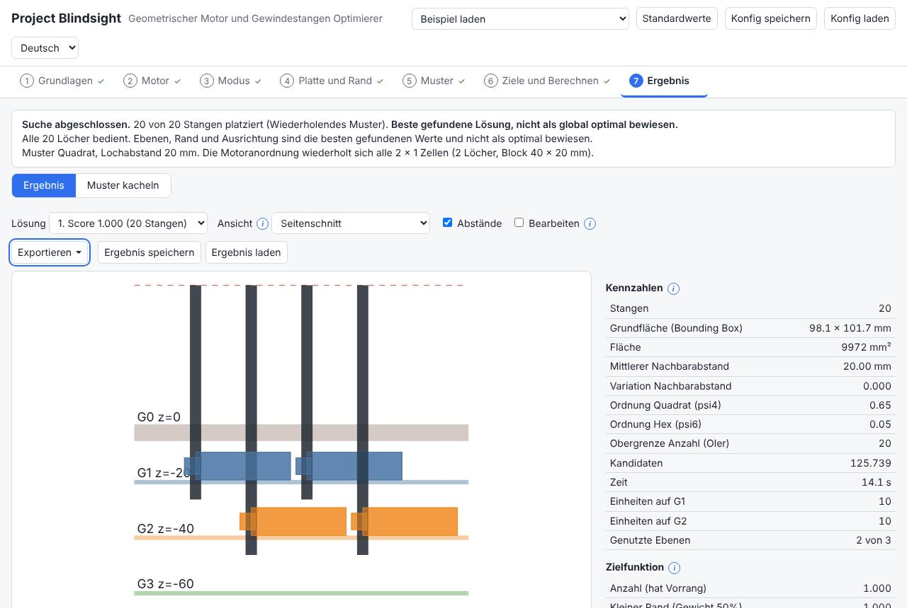

Rechts daneben
- Kennzahlen. Stangen, Grundfläche (Bounding Box), Fläche, Mittlerer Nachbarabstand, Variation Nachbarabstand (0 heißt alle
  gleich), Ordnung Quadrat (psi4) und Ordnung Hex (psi6) (1 heißt perfekt), Obergrenze Anzahl (Oler), Kandidaten, Zeit, Einheiten
  auf G1, G2 und so weiter, Genutzte Ebenen (zum Beispiel 2 von 3) und Tiefe im Randbereich
- Zielfunktion. Jedes Ziel mit Gewicht und Wert, Anzahl (hat Vorrang) und Gesamt
- Vergleich der Lösungen. Anzahl, Fläche und Score der besten Lösungen
- Engste Stellen. Die knappsten Abstände mit den beteiligten Bauteilen
- Hinweise. Meldungen der Suche, zum Beispiel warum ein Loch nicht bedient werden konnte
- Kollisionen. Im Normalfall Keine Kollisionen. Alle Abstände >= 1.05 mm

### 9.9 Muster kacheln

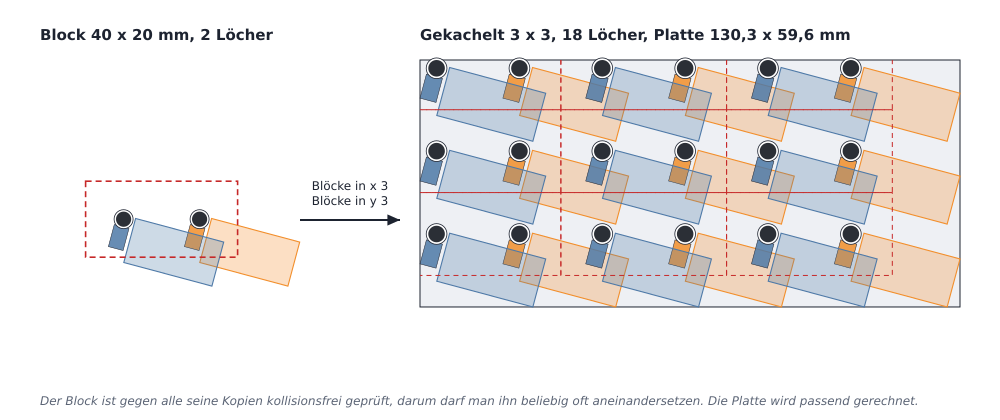

*Bild 8. Der Block aus Bild 4 drei mal drei mal aneinandergesetzt.*

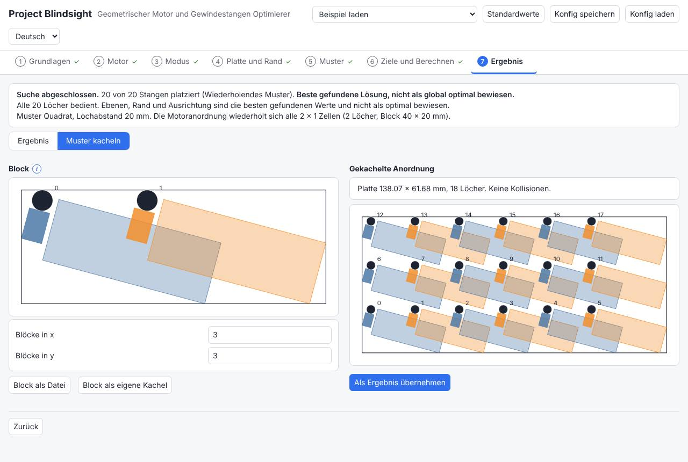

Die Seite Muster kacheln gibt es nur für Muster 2a, weil sich dort Löcher und Motoren als Block wiederholen.
- Links der Block mit Blöcke in x und Blöcke in y
- Rechts Gekachelte Anordnung mit Plattengröße, Lochzahl und der Prüfung Keine Kollisionen
- Als Ergebnis übernehmen setzt die Platte auf die passende Größe und zeigt die gekachelte Anordnung als Ergebnis. Hindernisse und
  Montagebereiche der alten Platte entfallen. Danach funktionieren alle Exporte damit
- Block als Datei speichert Löcher und Motorlagen des Blocks. Block als eigene Kachel speichert ihn als Lochbild Datei, die im
  Schritt Muster mit der Karte Eigene Kachel wieder geladen werden kann
- Bei 2b steht stattdessen ein Hinweis, dass sich nur die Löcher wiederholen und die Platte zu vergrößern und neu zu rechnen ist

### 9.10 Exportieren

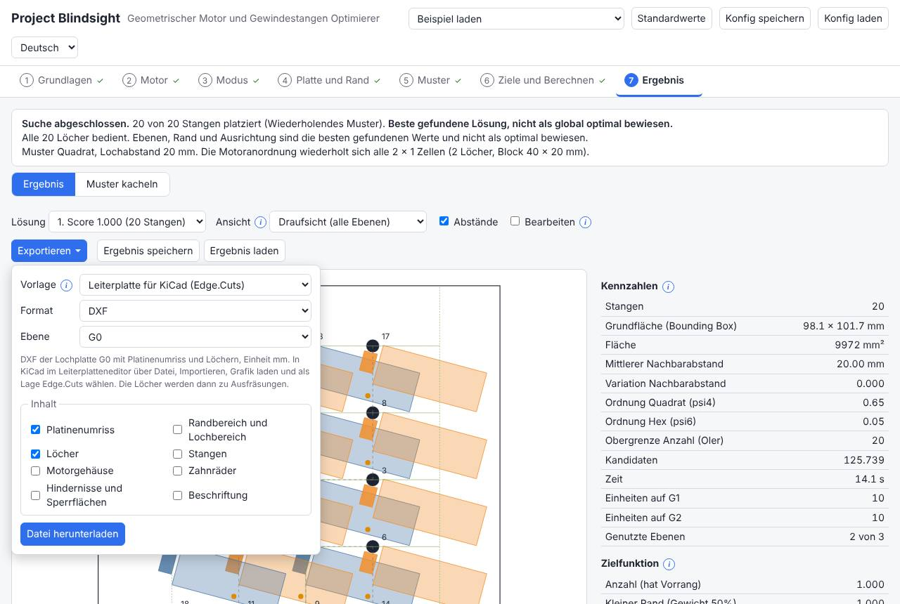

Exportieren öffnet ein Menü mit vier Teilen.
- Vorlage. Leiterplatte für KiCad (Edge.Cuts), Bohrschablone zum Ausdrucken, Motorebene für CAD, Alles, und Eigene Auswahl
- Format. SVG Zeichnung, Schraubenpositionen (JSON), JSON, DXF, Bohrliste CSV
- Ebene. Alle Ebenen oder eine von G0 bis Gn (nur Ebenen, die das Ergebnis hat). JSON enthält immer alle Ebenen
- Inhalt (bei SVG und DXF). Platinenumriss, Randbereich und Lochbereich, Löcher, Stangen, Motorgehäuse, Zahnräder, Hindernisse und
  Sperrflächen, Beschriftung, im SVG auch Abstände und Kollisionen

Datei herunterladen lädt die Datei. Mit einer Ebene trägt der Dateiname die Ebene, zum Beispiel `blindsight-G0.dxf`. Jede
Änderung von Hand macht aus einer Vorlage eine Eigene Auswahl. Ist nichts angehakt, ist der Download gesperrt.

| Format | Inhalt | Wofür |
|---|---|---|
| SVG Zeichnung | Maßstab 1:1 in mm. Mit allen Ebenen eine Draufsicht und je Motorebene ein Blatt, mit einer Ebene nur deren Blatt | Ansehen, Ausdrucken, Lasern |
| Schraubenpositionen (JSON) | Je Ebene die Stangen in den vier Gruppen aus Abschnitt 3.4, dazu je Stange Ebene, Winkel, Achsabstand und Lage der Zahnradachse | Weiterverarbeitung, als Lochbild wieder ladbar |
| JSON | Die gesamte Geometrie mit allen Konturen und z Werten | Austausch, eigene Auswertungen |
| DXF | R12, Einheit mm. Jeder Teil auf einer eigenen DXF Lage, `BOUNDS`, `TOP_RODS`, `Gn_MOTOR`, `Gn_GEAR`, `Gn_HOLES`, auf Wunsch `EDGE_MARGIN`, `HOLE_AREA`, `LABELS` | CAD, Leiterplatte |
| Bohrliste CSV | Je Ebene alle Durchgangslöcher mit x, y, Durchmesser, Motorebene, Winkel und Stangenlänge | Bohren, Tabellen |

Leiterplatte in KiCad
1. Vorlage Leiterplatte für KiCad (Edge.Cuts) wählen. Das ergibt ein DXF der Ebene G0 nur mit Platinenumriss und Löchern
2. Datei herunterladen
3. In KiCad im Leiterplatteneditor Datei, Importieren, Grafik wählen, die Datei öffnen und als Lage Edge.Cuts einstellen
4. Die Kreise werden zu Ausfräsungen in der Platine. Für durchkontaktierte Bohrungen bräuchte man stattdessen Footprints

## 10. Ein Durchlauf mit den Standardwerten

So entsteht Bild 4, Schritt für Schritt.
1. Grundlagen. Stange 4 mm, Hub 50 mm, drei Motorebenen im Abstand 20 mm, fest. Die Tabelle zeigt Stangen von 77, 97 und 117 mm
2. Motor. N20 mit Encoder, 12 x 32 x 10 mm, Zahnrad 6 x 4 mm, Achsabstand 5 mm
3. Modus. Muster wählen (beim Start der Oberfläche schon gewählt)
4. Platte und Rand. 120 x 120 mm, ohne Randbereich
5. Muster. Quadrat, Löcher und Motoren wiederholen sich, So viele wie auf die Platte passen, So klein wie möglich
6. Ziele. Kleiner Rand 50 %, Saubere Ausrichtung 50 %, Zeitlimit 20 s. Optimierung starten
7. Ergebnis nach etwa 14 Sekunden. 20 Löcher, Lochabstand 20 mm, Block 2 x 1 Zellen (40 x 20 mm) mit einem Motor auf G1 und
   einem auf G2, alle um 75 Grad gedreht, 2 von 3 Ebenen genutzt, keine Kollisionen. Ob ein noch kleinerer Abstand ginge, ist
   nicht bewiesen, darum steht im Statuskasten Beste gefundene Lösung

Zum Vergleich mit denselben Werten
- Muster 2b (nur die Löcher). 25 Löcher mit 23,5 mm Abstand, Motoren auf G1 bis G3 in vier Winkeln, nach etwa 2 Sekunden
- Nur eine Motorebene. 16 Löcher mit 27 mm Abstand

## 11. Was das Programm verspricht und was nicht

- Ehrlichkeit. Das Ergebnis heißt immer Beste gefundene Lösung. Optimal nennt das Programm eine Lösung nur, wenn sie die
  Obergrenze erreicht oder eine vollständige Suche es beweist. Die Obergrenze kommt aus der Ungleichung von Oler für Punkte mit
  Mindestabstand im Rechteck und berücksichtigt die Motoren nicht
- Jede ausgegebene Lösung wird zum Schluss noch einmal vollständig auf Kollisionen geprüft
- Unmöglichkeit wird bewiesen, wenn eine exakte Suche ohne Zeitlimit endet. Sonst heißt es nur, dass nichts gefunden wurde
- Annahmen. Das Zahnrad ist ein Quader ohne Zähne, der Eingriff steckt nur im Achsabstand. Gehäuse sind konvex. Die Stange zählt
  über den ganzen Weg als Zylinder. Die Platte ist ein Rechteck. Kabel, Stecker, Leiterbahnen und Festigkeit fehlen
- Der Standardmotor folgt typischen Händlerangaben für einen N20 mit Encoder. Die übrigen Standardwerte sind Platzhalter.
  Für einen echten Motor gehören seine gemessenen Maße hinein

## 12. Dateien und Formate

| Datei | Inhalt | Entsteht durch |
|---|---|---|
| Konfiguration (`.json`) | Alle Eingaben | Konfig speichern, Beispiele in `examples/` |
| Ergebnis (`blindsight-ergebnis.json`) | Konfiguration plus Platzierungen | Ergebnis speichern, Ergebnis laden |
| Lochbild (`blindsight.holes`) | Feste Löcher oder eine eigene Kachel, mm ab unten links | JSON herunterladen im Lochbild Editor, Block als eigene Kachel |
| Block (`blindsight.block`) | Löcher und Motorlagen eines Blocks von 2a | Block als Datei |
| Exporte | SVG, DXF, CSV, JSON, Schraubenpositionen | Exportieren |

Eine Platzierung besteht aus x und y der Stange, der Ebene (1 bis n), dem Motorwinkel und optional dem Achsabstand. Ein
Lochbild in JSON sieht so aus.

```json
{"format": "blindsight.holes", "version": 1, "units": {"length": "mm"},
 "holes": [{"id": 0, "x": 30, "y": 30}, {"id": 1, "x": 60, "y": 30}]}
```

## 13. Die Bilder dieser Datei neu erzeugen

- Die Schemabilder 1 bis 8 zeichnet `docs/make_images.py` aus dem Modell. Die Bilder 4, 7 und 8 rechnet das Skript jedes Mal neu
  mit den Optimierern (etwa 30 Sekunden)

```bash
PYTHONPATH=src python docs/make_images.py
```

- Die Bildschirmfotos der Oberfläche (`docs/images/ui_*.jpg`) zeigen den Stand von Version 0.11.0 mit den Standardwerten
