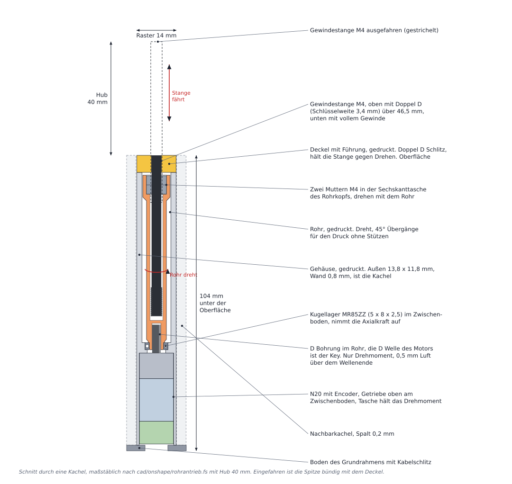
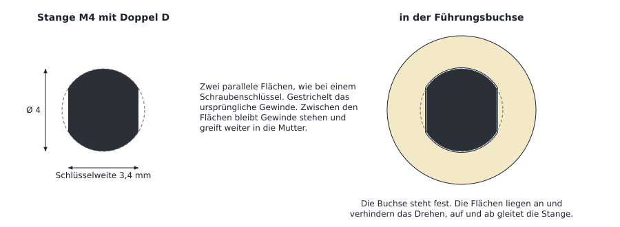

# Variante Rohrantrieb (Rohr mit Innengewinde)

Stand. Technische Untersuchung und CAD Umsetzung als einfache, druckbare Kachel in Onshape (Abschnitte 6 und 14). Alle Maße in mm.

Diese Datei untersucht den Vorschlag, die Gewindestange nicht mehr seitlich über ein Zahnrad anzutreiben, sondern über ein
drehendes Rohr mit Innengewinde und einem Motor darunter. Grundlage sind das Repository (README, `docs/ERKLAERUNG.md`) und
die Antworten des Teams. Werte, die nirgends festgelegt sind, sind als **Annahme** gekennzeichnet.



*Bild 9. Schnitt durch eine Kachel, maßstäblich nach dem Onshape Feature (Abschnitt 6).*

## Kurzfassung

- Das Prinzip funktioniert. Es ist eine bekannte Bauform (rotierende Mutter, hebende Spindel), wie in Linearschrittmotoren
  ohne Verdrehsicherung und in Spindelhubgetrieben mit hebender Spindel
- Die Stange hält Last ohne Strom (selbsthemmendes Gewinde). Mit einem schnellen N20 schafft sie bei 2 cm/s etwa 10 N.
  Das reicht für eine aufgelegte Hand mit Unterarm deutlich (Abschnitt 5)
- Bauform so einfach wie möglich. Ein Rohr mit offenem Ende oben, im offenen Ende ein M4 Innengewinde, darin die
  Gewindestange. Über dem offenen Ende sitzt die Sicherung gegen Verdrehen. Der N20 dreht das Rohr von unten
- Eine Kachel besteht aus vier Teilen. Gehäuse mit Sicherung und Rohr (beide gedruckt), Gewindestange und N20 (gekauft)
- Die Kacheln stehen ohne Lücke nebeneinander, Raster **14 x 12 mm**, in beliebiger Anzahl, in einer flachen Wanne

## 1. Ausgangslage und Quellen

| Angabe | Wert | Quelle |
|---|---|---|
| Ziel | Viele senkrechte Gewindestangen, jede mit eigenem Motor, möglichst dicht | README, `docs/ERKLAERUNG.md` |
| Bisheriger Antrieb | Zahnrad am seitlichen Motor schiebt die Stange wie eine Zahnstange, Motoren auf mehreren Ebenen | `docs/ERKLAERUNG.md` Abschnitt 3.6 |
| Stange | M4 (4 mm) | Standardwert der App |
| G0 Dicke | 6 mm | Standardwert der App |
| Sicherheitsabstand | 1 mm + 0,05 mm Toleranz | Standardwert der App |
| Motor | N20 mit Encoder, 12 x 10 mm, ohne Welle 32 mm lang, Welle Ø 3 mm D | Standard seit 0.11.0, Händlerangaben |
| Hub | 40 mm reichen, im Design als Parameter | Team |
| Geschwindigkeit | etwa 2 cm/s (1 cm in einer halben Sekunde) | Team |
| Last | Gewicht von Hand und Unterarm, aufgelegt ohne Drücken | Team |
| Ebenen | Die neue Variante verzichtet auf das Mehrebenen Konzept | Team |
| Motor neu bestellen | erlaubt | Team |

## 2. Korrektur zum bisherigen Zahnrad (mit dem Team abgestimmt)

- Selbsthemmend ist das seitliche Zahnrad nur, wenn es die Stange **drehen** soll (Schneckenrad treibt Schnecke)
- Im dokumentierten Konzept wird die Stange aber geschoben wie eine Zahnstange. Diese Längsbewegung ist nicht selbsthemmend
  und physikalisch möglich
- Die echten Schwächen sind das selbst gefräste Schneckenrad, sehr kleine Zähne (Modul etwa 0,22 bei M4), die 60 Grad Flanken,
  die Rad und Stange auseinanderdrücken, und dass die Stange Last ohne Strom nicht hält

## 3. Funktionsprinzip

- Das Rohr dreht sich, das Innengewinde im offenen Ende dreht mit. Die Stange kann sich nicht drehen (Verdrehsicherung) und fährt je
  Rohrumdrehung um eine Gewindesteigung, v = n · P
- Pflicht sind zwei Dinge. Die Stange ist gegen Drehung gesichert, und das Rohr ist axial fest gelagert
- Bekannte Mechanismen nach diesem Prinzip
  - Linearschrittmotoren "non captive". Eine Mutter im Hohlwellen Rotor, die Spindel muss von außen gegen Drehung gesichert werden
  - Spindelhubgetriebe mit hebender Spindel. Das Schneckenrad ist die Mutter, die Spindel taucht unten in ein Schutzrohr.
    Verdrehsicherung dort per Passfeder in einer Nut oder per Vierkantschutzrohr
  - Im Alltag Lippenstift und Klebestift
- Gegenüber der klassischen Spindel Mutter Bauart (Spindel dreht, Mutter fährt) ist hier die Stange selbst der Abtrieb. Für
  ein Stangenfeld ist das die passendere Bauart, es braucht keinen Schlitten neben der Stange

## 4. Anforderungen der Variante

- Hub 40 mm über der Oberfläche, eingefahren bündig mit der Oberfläche. Im CAD ein Parameter, damit andere Hübe ohne Umbau möglich sind
- Etwa 2 cm/s, also 2 s für den ganzen Hub
- Last einer aufgelegten Hand mit Unterarm halten und anheben
- Keine Ebenen mehr, alle Motoren koaxial unter ihrer Stange
- Möglichst dichtes, regelmäßiges Raster, das sich beliebig erweitern lässt
- Alle Sonderteile im 3D Druck herstellbar, nur Norm- und Kaufteile dazu, so wenige Teile wie möglich

## 5. Kräfte, Drehmomente, Reibung, Selbsthemmung

Gerechnet mit dem Flankenwinkel des metrischen Gewindes und einem Reibwert μ von 0,10 bis 0,20 (**Annahme**, Stahl auf Messing
geschmiert).

```
Steigungswinkel        λ = arctan(P / (π · d2))
Reibwinkel             ρ' = arctan(μ / cos 30°)
Drehmoment am Rohr     T = F · d2/2 · tan(λ + ρ')
Wirkungsgrad           η = tan λ / tan(λ + ρ')
selbsthemmend, wenn    λ < ρ'
```

| Gewinde | λ | T je N Last (μ 0,15) | η (μ 0,10 bis 0,20) | selbsthemmend | Rohrdrehzahl für 2 cm/s |
|---|---|---|---|---|---|
| M4 x 0,7 | 3,6° | 0,42 Nmm | 35 bis 21 % | ja | 1714 U/min |
| M5 x 0,8 | 3,3° | 0,52 Nmm | 33 bis 19 % | ja | 1500 U/min |
| M6 x 1 | 3,4° | 0,63 Nmm | 34 bis 20 % | ja | 1200 U/min |

- **Selbsthemmung.** λ liegt deutlich unter ρ' (6,6 bis 13°). Druck von oben dreht das Rohr nicht zurück, die Stange hält
  ohne Strom
- **Kraft bei 2 cm/s.** Ein N20 liefert höchstens etwa 1 W mechanisch. Grob bleibt F ≈ η · P / v ≈ 0,25 · 1 W / 0,02 m/s ≈
  10 bis 15 N je Stange, fast unabhängig vom Gewinde. Die Steigung ändert nur die nötige Drehzahl. Abgeschätzt aus Pololu Daten
  (12 V, 30:1) umgerechnet auf etwa 10:1
- **Langsamer heißt stärker.** Mit 30:1 wären es grob 40 N bei etwa 6 mm/s
- **Encoder.** Eine Motorumdrehung bewegt die Stange bei 10:1 um 0,07 mm. Die Auflösung liegt im Bereich von Tausendstel mm

**Reibung an der Stirnfläche.** Das Rohr steht ohne Kugellager auf der Getriebeplatte des Motors (Abschnitt 9). Diese
Gleitfläche kostet bei μ etwa 0,25 und einem mittleren Radius von 3,3 mm etwa 0,8 Nmm je N Last, also etwa doppelt so viel wie
das Gewinde. Die Kraft beim Anheben sinkt dadurch auf grob ein Drittel des Werts mit Kugellager, also etwa 4 bis 6 N je Stange.
Für die aufgelegte Hand reicht das weiter (siehe unten). Die Selbsthemmung wird dadurch noch sicherer.

**Prüfung mit der Hand.** Hand und Unterarm wiegen zusammen etwa 2,2 Prozent der Körpermasse (Segmenttabelle nach Winter).
- Bei 60 bis 90 kg Körpermasse sind das etwa 1,3 bis 2,0 kg, also 13 bis 20 N
- Liegt der Ellbogen auf, tragen die Stangen nur einen Teil davon
- Bei 14 x 12 mm Raster liegen unter einer Hand grob 55 bis 80 Stangen. Im Mittel trägt eine Stange deutlich unter 1 N, auch unter
  Fingerspitzen nur wenige N
- Halten ist durch die Selbsthemmung unkritisch. Anheben mit 10 bis 15 N je Stange hat großen Spielraum
- Ergebnis. Für diese Last reicht der Rohrantrieb mit N20 aus

## 6. Aufbau einer Kachel

Von oben nach unten, z = 0 ist die Oberfläche, Hub 40 mm. Die Werte stehen im Feature in `RB` und folgen aus dem N20 und den
Druckregeln (Wand 0,8 mm, Spalt zwischen Kacheln 0,2 mm, Tasche 0,1 mm Luft).

| Teil | Herkunft | Maße und Lage | Aufgabe |
|---|---|---|---|
| Gehäuse mit Sicherung | Druck | außen 13,8 x 11,8, z 0 bis -103, innen 12,2 x 10,2, oben 6 mm geschlossen mit Doppel D Schlitz 3,5 x Ø 4,2 | Ist die Kachel. Oben die Sicherung gegen Verdrehen, unten die Tasche für den Motor |
| Gewindestange | Kauf, M4 DIN 976 | Länge 58, oben Doppel D 3,4 über 46,5, darunter volles Gewinde | Abtrieb, eingefahren bündig, ausgefahren 40 über der Oberfläche |
| Rohr | Druck | Ø 8, z -7 bis -71. Oben offen mit M4 Innengewinde 8 lang, darunter Bohrung Ø 4,6, unten geschlossen mit D Bohrung 9,5 tief und Aussparung Ø 5 x 1 | Dreht, bewegt die Stange über das Gewinde |
| N20 Motor | Kauf, 12 V mit Encoder | Getriebe 12 x 10 x 9 oben (Stirn bei z -71), Motor 15, Encoder 8, D Welle Ø 3 mit Fläche auf 2,5, 10 lang, Lagerbund Ø 4 x 0,5 | Antrieb, trägt das Rohr |
| Wanne | Druck, eine für das ganze Feld | Boden 2 mm, Rand 2 mm dick und 10 mm hoch, Kabelschlitz 8 x 4 je Kachel | Hält die Kacheln zusammen, trägt die Last |

- Bautiefe 105 mm unter der Oberfläche, Raster 14 x 12 mm
- Lastpfad bei Druck von oben. Stange, Gewinde, Rohr, Stirnfläche des Rohres, Getriebeplatte, Motor, Boden der Wanne.
  Die Motorwelle bekommt nur das Drehmoment, sie endet 0,5 mm unter dem Boden der D Bohrung
- Zentrierung des Rohres. Unten durch die Motorwelle, oben über das Gewinde durch die Stange in der Sicherung. Zum Gehäuse
  bleibt rundum mindestens 1 mm Luft
- Nach oben hält das Rohr die Sicherung, 1 mm über dem offenen Ende
- Die Stange bleibt auch ganz ausgefahren 3 mm tiefer im Gewinde, als es lang ist

**Zusammenbau einer Kachel**
1. Gewinde in das offene Ende des Rohres schneiden (M4 Gewindebohrer, der Druck hat ein Kernloch Ø 3,3)
2. Stange in das Rohr schrauben
3. Stange von unten durch das Gehäuse in die Sicherung schieben, die Flächen ausrichten. Das Rohr folgt ins Gehäuse
4. Motor von unten einschieben, die D Welle in die D Bohrung (Fläche ausrichten), bis das Rohr auf der Getriebeplatte steht
5. Kachel in die Wanne stellen, Kabel durch den Schlitz

**Druck**
- Gehäuse kopfüber, die Oberfläche mit dem Schlitz liegt auf dem Druckbett. Keine Überhänge, keine Stützen
- Rohr stehend, unten die D Bohrung, oben das offene Ende. Die Fasen sind 45 Grad, keine Stützen
- Wanne liegend

## 7. Verdrehsicherung



*Bild 10. Doppel D heißt zwei parallele Flächen an der Stange, wie bei einem Schraubenschlüssel. Der Schlitz in der Sicherung hat
die gleiche Form und steht fest.*

Die Verdrehsicherung muss das volle Antriebsmoment aufnehmen (bis etwa 13 Nmm beim schnellen N20) und den ganzen Hub mitgehen.

| Variante | zusätzliche Bauhöhe | Bewertung |
|---|---|---|
| Pin quer durch die Stange, läuft in einem feststehenden Schlitz über dem Rohr (Vorschlag Lehrer) | mindestens Hub + Pin | Funktioniert. Die Querbohrung schwächt eine M4 Stange (Kern 3,1 mm) stark, der Schlitz muss genau achsparallel stehen |
| Unrundes Kopfstück oben an der Stange in einer unrunden Bohrung | Hub | Das Kopfstück müsste beim Ausfahren durch die Mutter, geht nur mit einer um einen Hub tieferen Mutter |
| Längsnut in der Stange, Stift in der Buchse | 0 | Bewährt bei Spindelhubgetrieben, in M4 schwer zu fräsen und schwächend |
| **Doppel D Abflachung, Schlitz in der Sicherung über dem offenen Ende** | **0** | **Gewählt.** Einfach herzustellen, das Moment wird direkt über dem Gewinde abgestützt |

- Warum nur Abflachung oder Nut ohne Bauhöhe auskommen. Derselbe Stangenabschnitt läuft während des Hubs durch die Sicherung und
  durch das Gewinde im Rohr. Alles Unrunde, das nicht durch die Mutter darf, kostet einen Hub an Höhe
- Auflage im Gewinde. Bei Schlüsselweite 3,4 bleiben etwa 65 Prozent der Gewindeauflage (mit nur einer Fläche etwa 80 Prozent).
  Bei der geringen Last ist das unkritisch
- Herstellung der Flächen. Die Stange in eine einfache Feilvorrichtung legen (Block mit Rille, gehärtete Anschlagfläche auf
  Sollhöhe), bis zur Anschlagfläche feilen, um 180 Grad drehen, wiederholen, mit der Schieblehre auf 3,4 mm prüfen. Mit
  einer Fräse geht es schneller
- Der Schlitz ist 6 mm lang und hat 0,05 mm Luft an den Flächen. PETG reicht für den Anfang. Verschleißt er, bekommt die
  Sicherung eine eingepresste Buchse aus POM oder Messing
- Die Reibung an den Flächen kostet bei etwa 5 bis 9 N Anlagekraft nur etwa 1 bis 2 N Längskraft

## 8. Herstellung des Rohres

- Ein PVC Rohr ganz mit dem Gewindebohrer durchzuschneiden, ist nicht zu empfehlen
  - PVC ist weich und kriecht unter Last, das Gewinde verschleißt
  - Billige Gewindestangen haben Steigungsfehler. Über eine lange Gewindestrecke klemmt die Stange dann
  - Nötig ist das Gewinde nur auf etwa 6 bis 8 mm
- Gewählt. Rohr im 3D Druck (PETG), das offene Ende mit Kernloch Ø 3,3, das M4 Gewinde 8 mm tief mit dem Gewindebohrer
  eingeschnitten. Darunter ist die Bohrung Ø 4,6, dort läuft der Gewindebohrer frei aus
- Verschleißt das gedruckte Gewinde, kommt eine M4 Messing Gewindebuchse (Einschmelzmutter) ins offene Ende
- Der Hub lässt sich später ändern, indem nur Stangen-, Rohr- und Gehäuselänge angepasst werden. Im CAD sind alle drei aus dem
  Parameter Hub abgeleitet

## 9. Lagerung, Seitenkräfte, Spiel

- Die Axialkraft zeigt nach unten. Sie geht über die Stirnfläche des Rohres (Ring Ø 5 bis Ø 7) auf die feststehende
  Getriebeplatte des N20, von dort über den Motor in den Boden der Wanne. Die Welle selbst bekommt keine Axialkraft, ein N20
  Getriebe ist dafür nicht ausgelegt
- Das ist ein Gleitlager ohne zusätzliches Teil. Es kostet etwas Kraft (Abschnitt 5). Reicht die Kraft nicht, kommt eine dünne
  Stahl- oder PTFE Scheibe zwischen Rohr und Getriebeplatte
- Die Aussparung Ø 5 x 1 unten im Rohr lässt den Lagerbund des Getriebes frei
- Seitenkraft an der ausgefahrenen Spitze. Sie wird in Sicherung und Gewinde etwa 4 bis 7 fach größer, weil die beiden
  Stützstellen nur etwa 9 mm auseinander liegen und die Spitze 40 mm übersteht. Gegenmittel ist die enge Passung im Schlitz
- Knicken ist kein Thema, eine M4 Stange knickt erst bei mehreren hundert N
- Gewindespiel (axial etwa 0,05 bis 0,1 mm) zeigt sich nur beim Richtungswechsel

## 10. Raster und Bauhöhe

- Die Kachel ist so groß wie der N20 plus zwei Wände. 12 + 2 x 0,1 Luft + 2 x 0,8 Wand + 0,2 Spalt = **14 mm** in x,
  10 + 0,2 + 1,6 + 0,2 = **12 mm** in y
- Das Rohr (Ø 8) passt mit 1 mm Luft in diesen Querschnitt
- Das Raster ist rechteckig. Stangenabstand 14 mm in x und 12 mm in y
- Auf 120 x 120 mm wären das 8 x 10 = 80 Stangen statt 20 im bisherigen Konzept mit den Standardwerten
- Bautiefe 105 mm unter der Oberfläche (bei Hub 40), etwas weniger als die längste Stange der bisherigen Variante (117 mm)

## 11. Vergleich der Varianten

| | Seitliches Zahnrad an Gewindestange | Zahnstange + Stirnrad | Rohrantrieb |
|---|---|---|---|
| Hält ohne Strom | nein | nein | **ja** |
| Kraft bei 2 cm/s mit N20, grob | 20 bis 35 N | 30 bis 45 N | 4 bis 6 N ohne Kugellager (reicht für die Hand) |
| Raster, grob | 20 mm, mehrere Ebenen | etwa 20 mm, mehrere Ebenen | **14 x 12 mm, eine Kachel je Stange** |
| Sonderteile | gefrästes Schneckenrad | keine | gedrucktes Gehäuse und Rohr, Abflachung an der Stange |
| Bauhöhe unter der Oberfläche | bis etwa 117 mm | ähnlich | 105 mm |

Ergebnis. Für die festgelegte Last ist der Rohrantrieb die beste der drei Varianten.

## 12. Stückliste je Kachel

| Anzahl | Teil | Herkunft |
|---|---|---|
| 1 | Gehäuse mit Sicherung | Druck PETG |
| 1 | Rohr, M4 Gewinde im offenen Ende eingeschnitten | Druck PETG |
| 1 | Gewindestange M4 DIN 976, 58 mm, Doppel D 3,4 auf 46,5 mm | Kauf, Flächen gefeilt |
| 1 | N20 Getriebemotor 12 V mit Hall Encoder, D Welle 10 mm | Kauf |

Für das ganze Feld dazu eine Wanne (Druck).

## 13. Plan für Onshape

Dokument "Ingenieurswettbewerb Motorvariante" (nicht "Ingenieurswettbewerb 2027 Paris").

Was die Onshape Werkzeuge des Assistenten können. Feature Studios lesen, anlegen und beschreiben, FeatureScript testen und
Geometrie per FeatureScript erzeugen. Sie können Dokumente nicht nach Namen suchen, keine Branches auflisten oder anlegen und
keine vorhandenen Features löschen. Daraus folgt der Ablauf.

1. **Team.** Im Dokument einen Branch von Main anlegen, Name "Rohrantrieb". Main bleibt dabei unverändert
2. **Team.** Den Link zu genau diesem Branch aus der Adresszeile des Browsers schicken und bestätigen, dass der Verbrauch von
   Onshape API Aufrufen in Ordnung ist
3. **Assistent, nur lesen.** Anmeldung prüfen, Feature Studios im Branch auflisten, vorhandenen Code lesen und den alten Stand
   zusammenfassen
4. **Assistent.** Im Branch ein Feature Studio "Rohrantrieb" anlegen. Darin ein parametrisches Feature, das alle Teile aus
   Abschnitt 6 als einzelne, benannte Teile erzeugt
5. **Assistent.** Das Feature testen, bis es fehlerfrei läuft, und im Feature die Abstände zwischen drehenden und feststehenden
   Teilen prüfen (mindestens Sicherheitsabstand)
6. **Team.** Im Branch ein neues Part Studio anlegen, das Feature einfügen und die alten Part Studios dieses Branches löschen.
   Das Löschen geht mit den Werkzeugen des Assistenten nicht, und Main ist davon nicht betroffen
7. **Assistent.** Die Änderungen im Branch hier in Abschnitt 14 dokumentieren und ins Repository schreiben
8. Später möglich. Die App um koaxiale Einheiten erweitern, damit sie Raster und Platte für diese Variante rechnet

## 14. Änderungen im Onshape Branch

Dokument "Ingenieurswettbewerb Motorvariante", nur im Branch des Teams
(`documents/7b861d28eaa305bc44dbf56d/w/e4a92442a8a34a2d035e8c98`). Main und alle anderen Stände sind unverändert, der
Assistent hat dort nichts gelesen oder geschrieben.

**Feature Studio "Rohrantrieb"** mit dem Feature "Rohrantrieb". Der Code liegt auch im Repository unter
`cad/onshape/rohrantrieb.fs` und ist dort die Vorlage. Änderungen gehen immer zuerst in diese Datei und dann ins Feature Studio.

Verlauf
1. Erster Stand mit Platten, Distanzbolzen, Führungsbuchse in G0, MF128ZZ und glatten Stangen, Raster 15 mm
2. Parameternamen nur in ASCII. Onshape lehnt Umlaute in den Namen der Eingabefelder ab, das Feature erschien sonst nicht
3. Druckbare Kachel mit Deckel, Rohr mit zwei Muttern, Kugellager MR85ZZ, Grund- und Abdeckrahmen, echtem Gewinde
4. Vereinfacht nach der Rückmeldung des Teams. Rohr mit offenem Ende und M4 Innengewinde, darüber die Sicherung als
   geschlossene Oberseite des Gehäuses. Keine Muttern, kein Kugellager, kein Deckel, keine Passstifte, eine flache Wanne
   statt zwei Rahmen. Vier Teile je Kachel. Die Schalter starten jetzt eingeschaltet. Vorher fehlte die Angabe "Default", darum
   war "Gewinde darstellen" im Dialog aus und das Gewinde nicht zu sehen

Parameter im Feature

| Parameter | Vorgabe | Bedeutung |
|---|---|---|
| Hub der Stange | 40 mm | höchste Stellung der Stangenspitze über der Oberfläche, bestimmt Stangen-, Rohr- und Gehäuselänge |
| Ausfahrstellung zur Ansicht | 20 mm | wie weit die Stangen im Modell gerade herausstehen (0 bis Hub) |
| Kacheln in x und y | 3 und 3 | Größe des Feldes, das Raster ergibt sich aus dem N20 |
| Gewinde darstellen | an | echtes Gewinde an Stange und Rohr. Aus rechnet das Modell schneller |
| Wanne erzeugen | an | Wanne unter dem Feld |
| Abstand messen und melden | an | misst die Abstände und zeigt sie als Hinweis am Feature, gelb bei zu kleinem Abstand |

Erzeugte Teile je Kachel, einzeln benannt und eingefärbt, mit der Nummer der Kachel. Gehäuse mit Sicherung (durchscheinend),
Rohr, Gewindestange M4, N20 Motor mit Encoder. Dazu die Wanne. Die erste Kachel wird gebaut, alle anderen sind Kopien davon.

Gewinde. Rechtsgewinde M4 x 0,7 als Trapez auf einer Schraubenlinie, außen an der Stange und innen im offenen Ende des Rohres.
Beide starten im gleichen Winkel und eine ganze Zahl von Steigungen auseinander, deshalb greifen sie in jeder Ausfahrstellung
ineinander, mit 0,05 mm Luft. Am besten sichtbar in der Schnittansicht.

Erwartete Abstände (aus den Maßen, Prüfung im Feature nach dem nächsten Lauf in Onshape)

| Prüfung | erwartet | mindestens |
|---|---|---|
| Stange zu Rohr (Gewindespiel) | 0,05 | 0,03 |
| Stange zu Sicherung (Führungsspiel) | 0,05 | 0,03 |
| Rohr zu Gehäuse | 1 | 0,5 |
| Motorwelle zu Rohr (D Sitz) | 0,05 | 0,03 |
| Motor zu Gehäuse | 0,1 | 0,05 |
| Gehäuse zu Nachbarkachel | 0,2 | 0,15 |
| Motor zu Nachbarmotor | 2 | 1,05 |

Gewollte Berührungen, darum nicht geprüft. Rohr auf der Getriebeplatte, Gehäuse und Motor auf dem Boden der Wanne.

**Vom Team einmalig von Hand.** Erledigt
1. Im Branch das alte Part Studio geleert
2. Feature "Rohrantrieb" eingefügt. Spätere Codeänderungen im Feature Studio wirken ohne weiteren Schritt im Part Studio

## 15. Offene Punkte

- Genaue Maße des bestellten N20 (Länge mit Encoder, Wellenlänge, Lage der Fläche, Lagerbund) nach Lieferung messen und in
  `RB` eintragen
- Reibwert und tatsächliche Kraft an einem ersten Muster messen, bei Bedarf Scheibe unter das Rohr
- Passungen nach einem Probedruck anpassen (Kernloch, D Bohrung, Doppel D Schlitz, Motortasche)
- Ob 0,8 mm Wand bei 103 mm Höhe steif genug ist

## Quellen

- Rotierende Mutter, Verdrehsicherung von außen [Nanotec non captive Linearaktuatoren](https://nanotec.com/eu/en/knowledge-base-article/non-captive-linear-actuators), [Patent US8978497B2](https://patents.google.com/patent/US8978497)
- Spindelhubgetriebe mit hebender Spindel und Verdrehsicherung [NEFF Datenblatt Bauart N](https://neff-gewindetriebe.de/fileadmin/PDF-Datenblaetter/spindelhubgetriebe/datenblatt_spindelhubgetriebe_N.pdf), [NEFF M J Serie](https://www.morskatedrivetechnology.com/wp-content/uploads/sites/3/2024/12/NEFF-Screw-jakcs-M-J-series.pdf.pdf), [Patent AT412643B](https://patents.google.com/patent/AT412643B/de)
- Wirkungsgrad und Selbsthemmung [Wikipedia Leadscrew](https://en.wikipedia.org/wiki/Leadscrew), [Roton Backdriving](https://roton.com/screw-university/screw-actions/screw-backdriving-efficiency)
- Motordaten [Pololu 12V HPCB 30:1](https://pololu.com/product/5210/specs)
- Lager der früheren Stände [MF128ZZ Datenblatt](https://www.smbbearings.com/firebrick/ckeditor/plugins/upload/Uploads/Documents/bearingpdfs/MF128ZZ-flanged-miniature-bearing-8x12x3.5mm.pdf), [MR128ZZ](https://wychbearings.co.uk/mr128zz_miniature_bearing_shielded.html)
- Körpersegmente [Segmenttabelle nach Winter, Ergänzungsdatei](https://brieflands.com/articles/ans-129929/supplementary-materials/ans-129929-Supplementary%20File.pdf)
